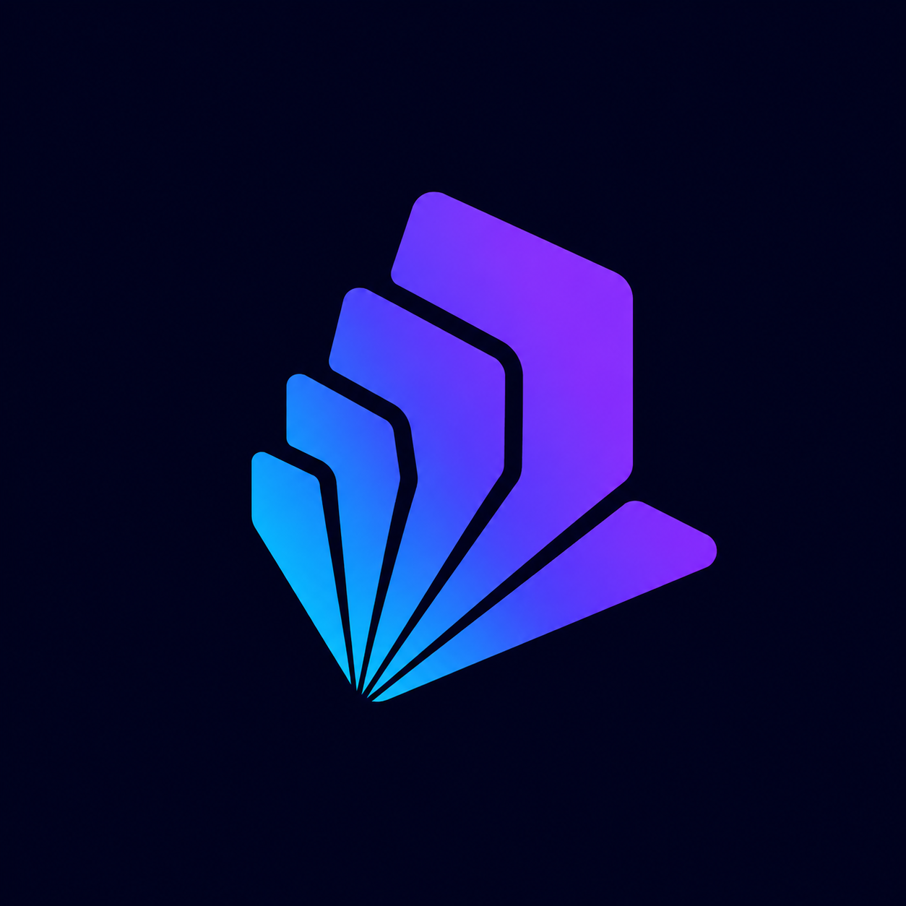

<p align="center">
  
</p>

# Deckle

**Local voice dictation for Windows 11. Your words land in the app you are typing in, and nothing leaves your machine.**

Press the hotkey, speak, and press it again when you are done. Deckle cuts your speech into utterances on your pauses and transcribes each one with a local Whisper model while you keep talking. A long pause becomes a new paragraph. The text goes to the clipboard, or straight into the focused field when you turn paste on.

**[Get the newest release](https://github.com/louisfifre/deckle/releases)**

> **Personal project, early public release.** Windows 11 x64, unpackaged, and installed per user without administrator privileges.

<p align="center">
  
</p>

## Dictation, how it works

- **One hotkey, pressed twice.** Win + the key left of 1 starts a take; the same key stops it. It is a toggle, so your hands are free while you speak. Every hotkey, this one included, can be changed in **Settings › General**.
- **Utterances cut on your pauses.** An energy threshold watches the microphone level and cuts an utterance when you pause long enough. A Silero voice-activity model then trims each utterance down to the speech it contains.
- **A local Whisper model.** Speech recognition runs through [whisper.cpp](https://github.com/ggerganov/whisper.cpp) on your GPU through Vulkan, with a CPU fallback. The default model is Whisper base (`ggml-base`, about 150 MB); Whisper large-v3 (about 3 GB) is available for better accuracy.
- **Transcription while you speak.** Each utterance is transcribed as soon as it is cut, so pressing stop only waits for the utterances still in the queue.
- **The text as it comes.** A panel beside the HUD shows each utterance's text as soon as it is transcribed. You pick its side, left or right, in **Settings › Dictation**.
- **A countdown before each cut.** While you pause, the HUD outline shows how much of the pause is left before the utterance is cut, and draws back when you speak again.
- **A pause becomes a paragraph.** Each utterance cut on a pause starts a new paragraph in the text.
- **Clipboard first, paste on request.** The text always goes to the clipboard. Paste is off by default; when you turn it on, Deckle pastes only into a field that UI Automation confirms is editable.
- **Optional rewrite.** A local [Ollama](https://ollama.com/) model can clean up the transcript before it is delivered, with the profile you choose once on the **Rewriting** page.
- **No length limit by default.** A **Maximum recording length** can be set on the **Recording** page.

Cutting into utterances is the Streaming pipeline, which you turn on in **Settings › Dictation**. With it off, the default for now, Deckle records the whole take and transcribes it in one pass after you press stop.

The full chain, step by step, is described in [docs/transcription-audio-chain.md](docs/transcription-audio-chain.md).

<p align="center">
  
</p>

## Also in the box

Deckle is one app with several modules. You choose them at setup and can change the selection later in Settings. A module you leave out stays inactive and out of Settings, and its models and runtimes are not downloaded.

| Module | What it adds | Status |
|---|---|---|
| **Dictation** | Voice transcription on a hotkey or from an audio file, through a local Whisper model. | Delivered, the most established module |
| **Rewrite** | A cleanup pass on the transcript through an Ollama model. Requires Dictation and a local Ollama. | Delivered; richer rewrite flows are still taking shape |
| **Autocorrect** | French-first accent restoration and conservative typo correction, in the apps you enroll. | Delivered |
| **Ambient light** | Screen color mapped to Philips Hue lights over the local network. | In progress |
| **Trackpad gestures** | Three-finger drag on a Windows precision touchpad. | Available |
| **Anytype workspace** | A local Anytype backend and an MCP surface that AI assistants can read and write. | Available |

A left click on the tray icon opens a quick-actions panel: Record, transcribe audio files, and one switch per module. A right click opens the classic menu for Settings, logs, restart and quit.

Smaller touches outside the module list: a **taskbar cover** that masks the taskbar with an opaque band (in progress); an **Apps and games** page, still foundations: a registry of your apps, filled by hand or from your Steam libraries and chosen folders, with an HDR rule per monitor applied while an app runs; **read-aloud**, scaffolded but dormant; and **precision scrolling** for finer mouse-wheel control, still groundwork.

<p align="center">
  
</p>

---

<!-- deckle-stats:start -->
## Development pulse

| First commit | Commits | Active days | Lines added | Lines touched | Current tracked lines |
|---:|---:|---:|---:|---:|---:|
| 2026-04-01 | 2,355 | 103 | 409,263 | 576,809 | 241,231 |

<sub>Generated from Git history on 2026-10-08. Counts include tracked text files only for the current line total.</sub>
<!-- deckle-stats:end -->

## Privacy and network use

- Speech recognition, autocorrect, and screen analysis run locally. Audio and ambient frames are never uploaded.
- Autocorrect never observes password fields and acts only in apps you enroll.
- Deckle sends no analytics. Optional diagnostic datasets are consent-gated and stored locally.
- Internet access is used to install and update Deckle, and to download once the models and native runtimes your modules need. Hue discovery can use Philips' service when you ask for it.
- Rewrite contacts the Ollama endpoint you configure, which defaults to the local machine.

## Install

1. Download **Deckle-Setup** from the newest entry on the [releases page](https://github.com/louisfifre/deckle/releases).
2. Run it and choose the modules you want.
3. Deckle installs per user, fetches any missing assets those modules require, and starts in the tray.

There is no administrator prompt. To start Deckle at login, enable **Settings → General → Launch at startup**.

## Build from source

On a fresh Windows 11 machine:

```powershell
git clone https://github.com/louisfifre/deckle.git
cd deckle
pwsh scripts/commands/setup/bootstrap-dev-env.ps1           # .NET 10, VS 2026, tooling
pwsh scripts/commands/build-run.ps1 -Configuration Release  # build and run
pwsh scripts/commands/build-run.ps1 -Configuration Release -NoRun  # build only
```

The scripts, their switches, and how the native runtime is sourced are documented in [scripts/README.md](scripts/README.md). How the dictation chain works, file by file, is in [docs/transcription-audio-chain.md](docs/transcription-audio-chain.md).

The code is split into `src/Deckle.*` modules behind one `Deckle.App` host, with tests in `tests/` and documentation in `docs/`.

## Contributing

Bug reports, reasoned proposals, and focused contributions are welcome. Ideas for extending the French-first corrector to other languages are especially useful; see [CONTRIBUTING.md](CONTRIBUTING.md) before opening a pull request.

## About

Deckle is built by one product designer, with the help of language models for architecture, native Windows work, and shipping discipline. It stays local, and it belongs to its user.

## Acknowledgements

Built on [whisper.cpp](https://github.com/ggerganov/whisper.cpp), [WinUI 3](https://github.com/microsoft/microsoft-ui-xaml) and the [Windows App SDK](https://github.com/microsoft/WindowsAppSDK), the [Windows Community Toolkit](https://github.com/CommunityToolkit/Windows), [Win2D](https://github.com/microsoft/Win2D), the [Vulkan SDK](https://www.lunarg.com/vulkan-sdk/), and the [Philips Hue](https://developers.meethue.com/) Entertainment API. Full attributions are in [NOTICE.md](NOTICE.md).

## License

MIT — see [LICENSE](LICENSE).
