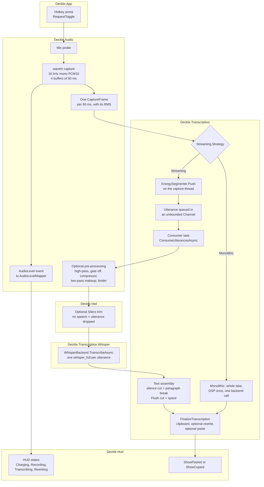
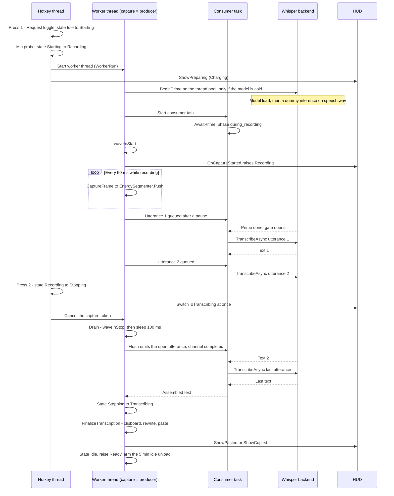

# The dictation chain

This note follows one dictation through Deckle, from the hotkey press to the text in the clipboard. It names each step, the file that does it, and the settings that change it. It is written to be read before the listening tests, so that a result can be traced back to a step and a parameter.

## How to read this note

Three markers tell you how solid each statement is.

- **Established**: read in the code. The file is named next to the statement. Most sentences in this note are of this kind, so they carry no extra marker.
- **Reading:** a paragraph that starts with this word is my interpretation of the code. It is likely, not proven.
- **Unverified**: something only running the app could show. The code alone cannot settle it.

Paths are relative to the repository root.

## Vocabulary

Most terms are defined in the module vocabularies. This list gives one line each and points to the file that owns the term.

- **Streaming** is the value `PipelineStrategyKind.Streaming` in `src/Deckle.Transcription/TranscriptionSettings.cs`. It is the pipeline that cuts the dictation into utterances while you speak and transcribes each one as soon as it ends. It does not mean that text appears on screen while you speak; Deckle has no such feature.
- **Monolithic** is the other value of the same enum. It captures the whole take, then makes one transcription call at the end.
- The code default is Monolithic, and the comment above the enum says the monolithic path "is slated for removal once streaming proves out".
- **Utterance** vs **segment**: an utterance is the audio span Deckle cuts and sends to Whisper in one call; a segment is a piece of text Whisper returns inside that call. See `src/Deckle.Transcription/CONTEXT.md`.
- **Neural VAD** vs **energy segmenter**: the neural VAD (Silero) is a model that finds speech inside a finished buffer; the energy segmenter is a volume threshold that cuts the live stream. See `src/Deckle.Transcription/CONTEXT.md`.
- **Hangover** vs **margin**: the hangover is how long the segmenter waits in silence before it decides an utterance has ended; the margin is how much of that silence it keeps at the end of the cut. See the header comment of `src/Deckle.Transcription/Streaming/EnergySegmenter.cs`.
- **Display level** vs **transcription pre-processing**: the display level only drives the HUD outline; pre-processing changes the audio sent to Whisper. See `src/Deckle.Audio/CONTEXT.md`.
- **Dictation** vs **file transcription**: the two entry points into the same pipeline. See `src/Deckle.Transcription/CONTEXT.md`.

## Diagram 1 — the chain, step by step

The main line is the Streaming path. The Monolithic path is the side branch at the strategy fork. Both end in the same finalize step.

Notes on the diagram:

- The hotkey is a toggle. The first press starts a take, the second press stops it. It is not push-to-talk (`RequestToggle` in `src/Deckle.Transcription/Engine/TranscriptionEngine.StateMachine.cs`).
- The fork is drawn after the frames for clarity. In the code, the strategy is chosen once per take in `WorkerRun`, before capture starts; the Monolithic path does not subscribe to frames.
- In Streaming, the pre-processing and the Silero trim run once per utterance, inside the consumer. In Monolithic, the pre-processing runs once over the whole take, and the Silero trim does not run at all (`src/Deckle.Transcription/Engine/TranscriptionEngine.MonolithicPipeline.cs`).
- File transcription is the second entry point: a tray command decodes an audio file and pushes its frames into the same energy segmenter, channel and consumer, then writes the text beside the file (`src/Deckle.Transcription/CONTEXT.md`, `src/Deckle.Transcription/Engine/TranscriptionEngine.FilePipeline.cs`). It is left out of the diagrams.

### Node → file

| Node | File (→ member) | What it does |
|---|---|---|
| Hotkey press | `src/Deckle.App/App.Hotkeys.cs` → `_engine.RequestToggle`; `src/Deckle.Transcription/Engine/TranscriptionEngine.StateMachine.cs` → `RequestToggle` | Win + the key left of 1 (`HOTKEY_ID_TRANSCRIBE` in `src/Deckle.Core/Interop/NativeMethods.cs`). Shift or Ctrl added picks a rewrite profile. A press while Idle starts; a press while Recording stops; any other state ignores the press. |
| Mic probe | `src/Deckle.Transcription/Engine/TranscriptionEngine.StateMachine.cs` → `TryStartFromIdleLocked` (`_capture.Probe`) | Checks the microphone before anything else. On failure, an error is shown and no take starts. Then the worker thread starts at AboveNormal priority. |
| waveIn capture | `src/Deckle.Audio/MicrophoneCapture.cs` → `Record` (`N_BUFFERS = 4`, `BYTES_PER_BUF` = 50 ms) | Opens the microphone at 16 kHz, mono, 16-bit, with a ring of four 50 ms buffers. |
| One CaptureFrame per 50 ms | `src/Deckle.Audio/Internal/WaveInLoop.cs` → `Pump`, `EmitSubWindows`; `src/Deckle.Audio/CaptureFrame.cs` | Cuts each buffer into 50 ms frames of 800 samples, computes the RMS (the average loudness) of each, and raises the `Frame` and `AudioLevel` events. |
| AudioLevel event | `src/Deckle.Audio/MicrophoneCapture.cs` → `AudioLevel`; `src/Deckle.App/App.Startup.Shell.cs` → `_engine.AudioLevel += _hudWindow.OnAudioLevel`; `src/Deckle.Audio/AudioLevelMapper.cs`; `src/Deckle.Hud/Chrono/HudChrono.Stroke.cs` | About 20 times per second, the RMS goes to the HUD, which maps it to the brightness of the outline. Display only. |
| Streaming.Strategy | `src/Deckle.Transcription/Engine/TranscriptionEngine.StateMachine.cs` → `WorkerRun` | Reads the strategy from the live settings at each take, so a change applies to the next dictation without restart. |
| EnergySegmenter.Push | `src/Deckle.Transcription/Streaming/EnergySegmenter.cs` → `Push`, `Flush`; called from `OnFrame` in `src/Deckle.Transcription/Engine/TranscriptionEngine.StreamingPipeline.cs` | Decides, frame by frame, whether you are speaking, pausing, or done. Runs on the capture thread. Detailed in the next section. |
| Utterance queued | `src/Deckle.Transcription/Streaming/SegmentedTranscriptionSession.cs` → `Channel.CreateUnbounded`; `src/Deckle.Transcription/Streaming/Utterance.cs` | Hands each finished utterance to the consumer. One writer, one reader, no size limit, plus a `Backlog` counter. |
| Consumer task | `src/Deckle.Transcription/Engine/TranscriptionEngine.StreamingPipeline.cs` → `ConsumeUtterancesAsync` | Takes utterances one by one, in order, and is the only caller of Whisper at a time. Waits at `AwaitPrime` before its first call. |
| Optional pre-processing | `src/Deckle.Audio/Preprocessing/TranscriptionPreprocessor.cs` → `Process`; `src/Deckle.Audio/Preprocessing/PreprocessingSettings.cs` | Off by default. When on: high-pass filter, noise gate (off), compressor, makeup gain to a target level in two passes, limiter. Works on a copy of the audio. |
| Optional Silero trim | `src/Deckle.Vad/VadService.cs` → `EnsureReady`; `src/Deckle.Vad/SileroVad.cs` → `Trim`; `src/Deckle.Vad/SileroSpeechTimestamps.cs` | On by default. Keeps only the speech inside the utterance. If no speech is found, the utterance is dropped. If the model file is missing, it starts a background download and this take runs untrimmed. |
| WhisperBackend.TranscribeAsync | `src/Deckle.Transcription.Whisper/WhisperBackend.Transcribe.cs` → `TranscribeSync`; `src/Deckle.Transcription.Whisper/Engine/WhisperParamsMapper.cs` → `Apply` | One `whisper_full` call per utterance. The prompt is the fixed `InitialPrompt` plus the last 30 words of the previous utterance (`BuildPriming`, `TailOf`, `PrimingTailWords`). Whisper's own VAD is forced off (`wparams.vad = 0`). |
| Text assembly | `src/Deckle.Transcription/Engine/TranscriptionEngine.StreamingPipeline.cs` → `pendingParagraphBreak = u.EndedOnSilence` | Joins the texts. After an utterance that ended on a silence, the next text starts a new paragraph (`\n\n`). After one closed by the final Flush, a space. |
| Monolithic | `src/Deckle.Transcription/Engine/TranscriptionEngine.MonolithicPipeline.cs` → `ProduceMonolithicAsync`; `src/Deckle.Transcription/Engine/TranscriptionEngine.Pipeline.cs` → `ConsumeMonolithicAudioAsync` | Captures the whole take, waits for the prime after Stop, runs the pre-processing once, makes one backend call. Whisper then cuts its own 30 s windows inside that call. |
| FinalizeTranscription | `src/Deckle.Transcription/Engine/TranscriptionEngine.Finalize.cs` → `FinalizeTranscription`, `CopyToClipboard`, `DeliverTranscript`, `PasteFromClipboard`; `src/Deckle.Transcription/Engine/TranscriptionEngine.Finalize.Rewrite.cs` → `ApplyRewrite` | Copies the raw text to the clipboard first. Then, if a rewrite profile applies, rewrites it with Ollama. Then pastes with Ctrl+V only if paste is enabled, the foreground window is not Deckle, and UI Automation confirms the focused element is a text field (Edit or Document). Paste is off by default (`AutoPasteEnabled = false` in `src/Deckle.Settings/Persistence/AppSettings.cs`). |
| HUD states | `src/Deckle.App/App.Startup.Shell.cs` → `StatusChanged` handler; `src/Deckle.App/App.Hotkeys.cs` → `ShowPreparing`, `SwitchToTranscribing`; `src/Deckle.Hud/Model/HudState.cs`; `src/Deckle.Hud/Windows/HudWindow.State.cs` | Start press → Charging. "Recording" status → Recording. Stop press → Transcribing at once. "Rewriting…" status → Rewriting. |
| ShowPasted or ShowCopied | `src/Deckle.App/App.Startup.Shell.cs` → `TranscriptionFinished` handler | Pasted → green flash. ClipboardOnly → the "copied" message. No text → the HUD hides. |

## Diagram 2 — one Streaming take over time

This diagram shows who does what, and when. The key point is that utterances are transcribed while you are still speaking, so at Stop only the last ones remain.

Notes on the diagram:

- On a warm model (used in the last 5 minutes), `BeginPrime` returns a finished task at once, and the consumer does not wait.
- On a cold model, the first utterances wait in the channel until the prime is done. The wait is hidden behind the recording, which is why its phase is named `during_recording` (`ConsumeUtterancesAsync`). In Monolithic the same wait happens after Stop and is named `at_stop`.
- The prime survives a Stop: it uses the drain token, which only Dispose cancels (`BeginPrime` in `src/Deckle.Transcription/Engine/TranscriptionEngine.Lifecycle.cs`).
- Reading: the two Whisper calls never overlap. The consumer is a sequential loop, the prime gate orders the first call after the dummy one, and `_transcribeLock` in `src/Deckle.Transcription.Whisper/WhisperBackend.Transcribe.cs` serialises native calls anyway.
- The engine state stays Stopping while the consumer drains the backlog. It moves to Transcribing only once the text is assembled. The HUD already shows Transcribing since the second press (`src/Deckle.App/App.Hotkeys.cs`).

### Node → file

| Step | File (→ member) |
|---|---|
| Press 1, Idle → Starting → Recording | `src/Deckle.Transcription/Engine/TranscriptionEngine.StateMachine.cs` → `RequestToggle`, `TryStartFromIdleLocked`; states in `src/Deckle.Transcription/Engine/TranscriptionEngine.cs` → `PipelineState` |
| ShowPreparing (Charging) | `src/Deckle.App/App.Hotkeys.cs` → `ToggleResult.Started`; `src/Deckle.Hud/Windows/HudWindow.State.cs` → `ShowPreparing` |
| Worker thread | `src/Deckle.Transcription/Engine/TranscriptionEngine.StateMachine.cs` → `WorkerRun` (`ThreadPriority.AboveNormal`) |
| BeginPrime, dummy inference | `src/Deckle.Transcription/Engine/TranscriptionEngine.Lifecycle.cs` → `BeginPrime`, `EnsurePrimed`, `TryLoadWarmupClip` (reads `Assets/Sounds/speech.wav` next to the exe) |
| Consumer task, AwaitPrime | `src/Deckle.Transcription/Engine/TranscriptionEngine.StreamingPipeline.cs` → `StartSegmentedTranscription`, `ConsumeUtterancesAsync`; `src/Deckle.Transcription/Engine/TranscriptionEngine.Lifecycle.cs` → `AwaitPrime` |
| waveInStart, Recording | `src/Deckle.Audio/MicrophoneCapture.cs` → `CaptureStarted`; `src/Deckle.Transcription/Engine/TranscriptionEngine.StateMachine.cs` → `OnCaptureStarted` |
| Frames to the segmenter | `src/Deckle.Transcription/Engine/TranscriptionEngine.StreamingPipeline.cs` → `ProduceStreamingAsync` (`OnFrame`); `src/Deckle.Transcription/Streaming/SegmentedTranscriptionSession.cs` → `Push` |
| Utterance queued | `src/Deckle.Transcription/Streaming/EnergySegmenter.cs` → `EmitOnSilence`; `src/Deckle.Transcription/Streaming/SegmentedTranscriptionSession.cs` → `TryWrite` |
| TranscribeAsync | `src/Deckle.Transcription.Whisper/WhisperBackend.Transcribe.cs` → `TranscribeAsync` |
| Press 2, Recording → Stopping | `src/Deckle.Transcription/Engine/TranscriptionEngine.StateMachine.cs` → `RequestToggle` (`_recordCts.Cancel`) |
| SwitchToTranscribing at once | `src/Deckle.App/App.Hotkeys.cs` → `ToggleResult.Stopped` |
| Drain | `src/Deckle.Audio/Internal/WaveInLoop.cs` → `waveInStop`, `Thread.Sleep(100)`, last `EmitSubWindows` pass |
| Flush, channel completed | `src/Deckle.Transcription/Streaming/SegmentedTranscriptionSession.cs` → `Complete`; `src/Deckle.Transcription/Streaming/EnergySegmenter.cs` → `Flush` |
| Stopping → Transcribing | `src/Deckle.Transcription/Engine/TranscriptionEngine.StreamingPipeline.cs` → `ProduceStreamingAsync` (CAS after `session.Completion`) |
| Finalize | `src/Deckle.Transcription/Engine/TranscriptionEngine.Finalize.cs` → `FinalizeTranscription` |
| ShowPasted or ShowCopied | `src/Deckle.App/App.Startup.Shell.cs` → `TranscriptionFinished` handler |
| Idle, Ready, idle unload | `src/Deckle.Transcription/Engine/TranscriptionEngine.StateMachine.cs` → `SettleWorkerToIdle`; `src/Deckle.Transcription/Engine/TranscriptionEngine.Lifecycle.cs` → `ResetIdleTimer`, `UnloadModel`; `MODEL_IDLE_TIMEOUT_MS` in `src/Deckle.Transcription/Engine/TranscriptionEngine.cs` |

## Parameters

Where the files live:

- Transcription settings are stored in `<UserDataRoot>/modules/transcription/settings.json` (comment at the top of `src/Deckle.Transcription/TranscriptionSettings.cs`).
- Every settings file writes its keys in camelCase (`JsonNamingPolicy.CamelCase` in `src/Deckle.Transcription/TranscriptionSettingsService.cs`, `src/Deckle.Audio/CaptureSettingsService.cs` and `src/Deckle.Settings/Persistence/SettingsService.cs`). The section column below uses those keys.
- Audio settings are stored in `<UserDataRoot>/modules/audio/settings.json` (`src/Deckle.Audio/CaptureSettingsService.cs`). The file holds `CaptureSettings` at its root.
- `AutoPasteEnabled` lives in the app-wide `<UserDataRoot>/settings.json`, section `paste` (`src/Deckle.Settings/Persistence/AppSettings.cs`, `SettingsFilePath` in `src/Deckle.Core/Paths/AppPaths.cs`).
- `<UserDataRoot>` is `%LOCALAPPDATA%\Deckle`, unless the `DECKLE_DATA_ROOT` environment variable is set (`src/Deckle.Core/Paths/AppPaths.cs`).

Where the settings are shown:

- **Settings ▸ Dictation**: `src/Deckle.Transcription/ViewModels/WhisperViewModel.Settings.cs` (composed cards), plus the hand-written cards of `src/Deckle.Transcription/WhisperPage.xaml` and `src/Deckle.Transcription/WhisperPage.xaml.cs` (model, language, initial prompt).
- **Playground ▸ Segmentation**: `src/Deckle.Playground/ViewModels/SegmentationViewModel.cs`, with the curve plot `src/Deckle.Transcription/Ui/Controls/HangoverCurveCanvas.xaml.cs` on `src/Deckle.Playground/Views/Segmentation/SegmentationPage.xaml`. Edits there wait for a Save button.
- **Settings ▸ Recording**: `src/Deckle.Audio/RecordingViewModel.Settings.cs`, plus the microphone picker in `src/Deckle.Audio/RecordingPage.xaml.cs`.

### Transcription module — `modules/transcription/settings.json`

| Parameter | Acts in | Default in code | Stored in (section) | Exposed where |
|---|---|---|---|---|
| `Engine.Model` | `src/Deckle.Transcription.Whisper/WhisperBackend.Model.cs` (model load) | `"ggml-base.bin"` | `engine` | Dictation (model card, `WhisperPage.xaml`) |
| `Engine.UseGpu` | `src/Deckle.Transcription.Whisper/WhisperBackend.Model.cs` | `true` | `engine` | Dictation (`WhisperUseGpuCard`) |
| `Engine.Language` | `src/Deckle.Transcription.Whisper/Engine/WhisperParamsMapper.cs` | `"fr"` | `engine` | Dictation (`WhisperPage.xaml.cs`) |
| `Engine.InitialPrompt` | `src/Deckle.Transcription.Whisper/Engine/WhisperParamsMapper.cs`; in Streaming, the fixed part of every prompt (`ProduceStreamingAsync`) | A French paragraph about coding a Windows app (see the file) | `engine` | Dictation (`WhisperInitialPromptCard`) |
| `Engine.CarryInitialPrompt` | `src/Deckle.Transcription.Whisper/Engine/WhisperParamsMapper.cs` | `true` | `engine` | Not exposed |
| `Confidence.EntropyThreshold` | `src/Deckle.Transcription.Whisper/Engine/WhisperParamsMapper.cs` | `2.4` | `confidence` | Dictation (`WhisperEntropyCard`) |
| `Confidence.LogprobThreshold` | same | `-1.0` | `confidence` | Dictation (`WhisperLogprobCard`) |
| `Confidence.NoSpeechThreshold` | same | `0.6` | `confidence` | Dictation (`WhisperNoSpeechCard`) |
| `Decoding.Temperature` | same | `0.0` | `decoding` | Dictation (`WhisperTemperatureCard`) |
| `Decoding.TemperatureIncrement` | same | `0.2` | `decoding` | Dictation (`WhisperTemperatureIncrementCard`) |
| `Decoding.UseBeamSearch` | same | `true` | `decoding` | Dictation (`WhisperUseBeamSearchCard`) |
| `Decoding.BeamSize` | same | `5` | `decoding` | Dictation (`WhisperBeamSizeCard`, visible when beam search is on) |
| `Context.UseContext` | same (`no_context`) | `true` | `context` | Dictation (`WhisperUseContextCard`) |
| `Context.MaxTokens` | same (`n_max_text_ctx`) | `-1` (auto) | `context` | Dictation (`WhisperMaxTokensCard`) |
| `OutputFilters.SuppressNonSpeechTokens` | same | `true` | `outputFilters` | Dictation (`WhisperSuppressNstCard`) |
| `OutputFilters.SuppressBlank` | same | `true` | `outputFilters` | Dictation (`WhisperSuppressBlankCard`) |
| `OutputFilters.SuppressRegex` | same | `""` | `outputFilters` | Dictation (`WhisperSuppressRegexCard`) |
| `Streaming.Strategy` | `src/Deckle.Transcription/Engine/TranscriptionEngine.StateMachine.cs` → `WorkerRun` | `Monolithic` | `streaming` | Dictation (`WhisperStreamingEnabledCard` toggle: on = Streaming) |
| `Streaming.Segmenter.ThresholdDbfs` | `src/Deckle.Transcription/Streaming/EnergySegmenter.cs` | `-45.0` | `streaming.segmenter` | Dictation (number field) and Playground |
| `Streaming.Segmenter.HangoverMaxMs` | same | `5000` | `streaming.segmenter` | Dictation and Playground |
| `Streaming.Segmenter.HangoverMinMs` | same | `500` | `streaming.segmenter` | Dictation and Playground |
| `Streaming.Segmenter.HangoverRampStartMs` | same | `15000` | `streaming.segmenter` | Dictation and Playground |
| `Streaming.Segmenter.HangoverRampEndMs` | same | `120000` | `streaming.segmenter` | Dictation and Playground |
| `Streaming.Segmenter.HangoverCurveX1` | same (via `src/Deckle.Transcription/Curves/UnitBezier.cs`) | `0.85` | `streaming.segmenter` | Playground only |
| `Streaming.Segmenter.HangoverCurveY1` | same | `0.10` | `streaming.segmenter` | Playground only |
| `Streaming.Segmenter.HangoverCurveX2` | same | `0.90` | `streaming.segmenter` | Playground only |
| `Streaming.Segmenter.HangoverCurveY2` | same | `0.25` | `streaming.segmenter` | Playground only |
| `Streaming.Segmenter.MarginMs` | same | `150` | `streaming.segmenter` | Dictation and Playground |
| `Streaming.Segmenter.MinUtteranceMs` | same | `250` | `streaming.segmenter` | Dictation and Playground |
| `Streaming.SpeechTrim.Enabled` | `src/Deckle.Transcription/Engine/TranscriptionEngine.StreamingPipeline.cs` → `StartSegmentedTranscription` | `true` | `streaming.speechTrim` | Dictation (`WhisperVadEnabledCard`, visible only when Streaming is on) |
| `Streaming.SpeechTrim.Threshold` | `src/Deckle.Vad/SileroSpeechTimestamps.cs` (via `src/Deckle.Vad/SileroVadOptions.cs`) | `0.5` | `streaming.speechTrim` | Dictation slider, same visibility |
| `Streaming.SpeechTrim.MinSpeechDurationMs` | same | `250` | `streaming.speechTrim` | Dictation slider, same visibility |
| `Streaming.SpeechTrim.MinSilenceDurationMs` | same | `100` | `streaming.speechTrim` | Dictation slider, same visibility |
| `Streaming.SpeechTrim.SpeechPadMs` | same | `30` | `streaming.speechTrim` | Dictation slider, same visibility |

The seven segmenter values on the Dictation page are number fields shown when the Streaming toggle is on. The four Silero values are sliders shown when both Streaming and the VAD toggle are on. The four curve control points can be edited only in the Playground: no Settings descriptor names them.

### Audio module — `modules/audio/settings.json`

| Parameter | Acts in | Default in code | Stored in (section) | Exposed where |
|---|---|---|---|---|
| `AudioInputDeviceId` | `src/Deckle.Audio/MicrophoneCapture.cs` (`Probe`, `Record`) | `-1` (system default device) | root | Recording (microphone picker, `RecordingPage.xaml.cs`) |
| `MaxRecordingDurationSeconds` | `src/Deckle.Audio/Internal/WaveInLoop.cs` (cap check) | `20 * 60` (20 min) | root | Not exposed anywhere |
| `LevelWindow.MinDbfs` | `src/Deckle.Audio/AudioLevelMapper.cs` (HUD display only) | `-55` | `levelWindow` | Recording (`GeneralVoiceLevelFloorCard`) |
| `LevelWindow.MaxDbfs` | same | `-32` | `levelWindow` | Recording (`GeneralVoiceLevelCeilingCard`) |
| `LevelWindow.DbfsCurveExponent` | same | `1.0` | `levelWindow` | Recording (`GeneralVoiceLevelCurveCard`) |
| `LevelWindow.AutoCalibrationEnabled` | `src/Deckle.Transcription/Engine/TranscriptionEngine.Telemetry.cs` → `TryAutoCalibrate` | `false` | `levelWindow` | Recording (master of `GeneralVoiceLevelExpander`, inverted: on = manual) |
| `LevelWindow.AutoCalibrationSamples` | same | `5` | `levelWindow` | Not exposed |
| `Preprocessing.Enabled` | `src/Deckle.Audio/Preprocessing/TranscriptionPreprocessor.cs` | `false` | `preprocessing` | Recording (`RecordingPagePreprocessingCard`) |
| `Preprocessing.HighPassEnabled`, `HighPassHz` | same | `true`, `90` Hz | `preprocessing` | Not exposed |
| `Preprocessing.GateEnabled`, `GateThresholdDbfs`, `GateRatio`, `GateAttackMs`, `GateReleaseMs` | same | `false`, `-55`, `2`, `5`, `150` | `preprocessing` | Not exposed |
| `Preprocessing.CompressorEnabled`, `CompThresholdDbfs`, `CompRatio`, `CompKneeDb`, `CompAttackMs`, `CompReleaseMs` | same | `true`, `-24`, `2`, `6`, `8`, `150` | `preprocessing` | Not exposed |
| `Preprocessing.TargetRmsDbfs`, `MaxMakeupGainDb` | same | `-20`, `24` | `preprocessing` | Not exposed |
| `Preprocessing.LimiterEnabled`, `LimiterCeilingDbfs`, `LimiterReleaseMs` | same | `true`, `-1`, `50` | `preprocessing` | Not exposed |

The pre-processing has 18 fixed fields after `Enabled`: four stage switches and fourteen values. `PreprocessingSettings.cs` says they are "an engineer's starting point, NOT measured optima". A comment in `src/Deckle.Audio/CaptureSettings.cs` says the fine parameters "live in the Playground"; no Playground file references them, so that comment is out of date.

Reading: `LevelWindowSettings` uses public fields, while every other settings class uses properties "so System.Text.Json round-trips them". Whether the level window survives a restart is not established here.

### Constants in the engine, not stored

| Constant | Where | Value | Exposed |
|---|---|---|---|
| `PrimingTailWords` | `src/Deckle.Transcription/Engine/TranscriptionEngine.StreamingPipeline.cs` | `30` words of the previous utterance added to the prompt | No |
| `MODEL_IDLE_TIMEOUT_MS` | `src/Deckle.Transcription/Engine/TranscriptionEngine.cs` | `5 * 60 * 1000` (5 min) before the model is freed | No |
| `N_BUFFERS`, `BYTES_PER_BUF` | `src/Deckle.Audio/MicrophoneCapture.cs` | 4 buffers of 50 ms (1600 bytes) | No |
| `FrameMs` | `src/Deckle.Transcription/Streaming/EnergySegmenter.cs` | `50` ms; every segmenter duration is rounded to whole frames | No |

### Louis's own values

Louis reports that he runs the Streaming strategy with the segmenter threshold at −38 dBFS. Both values live in his own `settings.json`, outside the repository, so this note cannot establish them. The code defaults stay Monolithic and −45 dBFS.

## Latencies

### What the code measures for each take

At the end of each dictation, `RecordPipelineMetrics` emits the `LatencyRecorded` event (`src/Deckle.Transcription/Engine/TranscriptionEngine.Finalize.Observability.cs`). It is not emitted for file transcription. These are the only per-take timings the code measures.

| Field | Start → end | Where it is measured |
|---|---|---|
| `model_load_ms` | Model load, cold takes only; 0 when warm | `LoadModel` in `src/Deckle.Transcription/Engine/TranscriptionEngine.Lifecycle.cs` |
| `hotkey_to_capture_ms` | Start press → `waveInStart` | `_hotkeySw`, started in `TryStartFromIdleLocked`, stopped in `OnCaptureStarted` |
| `record_drain_ms` | `waveInStop` → last buffers read | `DrainDuration` in `src/Deckle.Audio/Internal/WaveInLoop.cs` |
| `stop_to_pipeline_ms` | Stop press → Streaming: consumer finished draining; Monolithic: handoff to the backend | `_stopToPipelineSw`, started in `RequestToggle`, stopped in `ProduceStreamingAsync` or `ProduceMonolithicAsync` |
| `whisper_init_ms` | Whisper's init phase, summed over all utterances | `InitDurationMs` of each `TranscriptionResult` |
| `whisper_ms` | Whisper's total time minus init, summed over all utterances | same |
| `llm_ms` | Ollama rewrite, 0 without a profile | `src/Deckle.Transcription/Engine/TranscriptionEngine.Finalize.Rewrite.cs` |
| `clipboard_ms` | Raw copy to the clipboard | `FinalizeTranscription` |
| `paste_ms` | UI Automation check plus Ctrl+V, 0 when paste is off | `DeliverTranscript` |

On a cold take, `AwaitPrime` also emits `PrimeOverlap` with the prime's own duration, the time the gate actually waited, and the phase (`during_recording` or `at_stop`) (`src/Deckle.Transcription/Engine/TranscriptionEngine.Lifecycle.cs`). It shows how much of the cold cost the recording hid.

Reading: in Streaming, `stop_to_pipeline_ms` is the delay you feel after the second press, minus finalize. It includes the drain and the transcription of whatever utterances were still queued.

The Latency toggle on the Dictation page (`GeneralLatencyCard`) says it records these timings to `latency.jsonl`. Unverified: whether it is on by default and how the toggle gates the event; this note does not trace it.

A code comment in `EnsurePrimed` says the dummy inference takes "~200–800 ms on RX 7900 XT with Vulkan ggml". That is a comment, not a measurement this note can rely on.

### Delays built into the code

These are fixed by the code. They are not measured; they are the minimum or the step size of each stage.

| Delay | Value | Where |
|---|---|---|
| Capture frame | 50 ms (800 samples at 16 kHz) | `src/Deckle.Audio/Internal/WaveInLoop.cs` → `EmitSubWindows` |
| Capture ring | 4 × 50 ms = 200 ms of headroom before the driver drops audio | `src/Deckle.Audio/MicrophoneCapture.cs` |
| Capture poll | `WaitForSingleObject(hEvent, 100)`: wakes on each buffer, or after 100 ms at most | `src/Deckle.Audio/Internal/WaveInLoop.cs` |
| Drain after Stop | `waveInStop`, then `Thread.Sleep(100)`: at least 100 ms | `src/Deckle.Audio/Internal/WaveInLoop.cs` |
| Margin | 150 ms of silence kept after the last voiced frame | `EnergySegmenterSettings.MarginMs` |
| Hangover | 500 ms to 5 s of silence before a cut, depending on how long the utterance already is | `EnergySegmenterSettings.HangoverMinMs`, `HangoverMaxMs` |
| Heartbeat log | once per second (every 20 frames), only when verbose logging is on | `OnFrame` in `src/Deckle.Transcription/Engine/TranscriptionEngine.StreamingPipeline.cs` |
| Idle unload | model freed 5 min after the last take | `MODEL_IDLE_TIMEOUT_MS` in `src/Deckle.Transcription/Engine/TranscriptionEngine.cs` |

Reading: the hangover is the largest built-in delay. An utterance is handed to Whisper only once its trailing silence reaches the hangover. With the defaults, a sentence shorter than 15 s waits for 5 s of silence. The next section explains this.

## Segmentation

See the next section.
