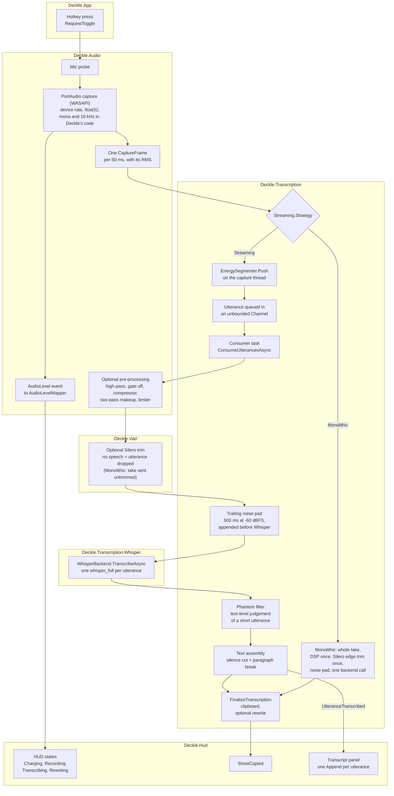
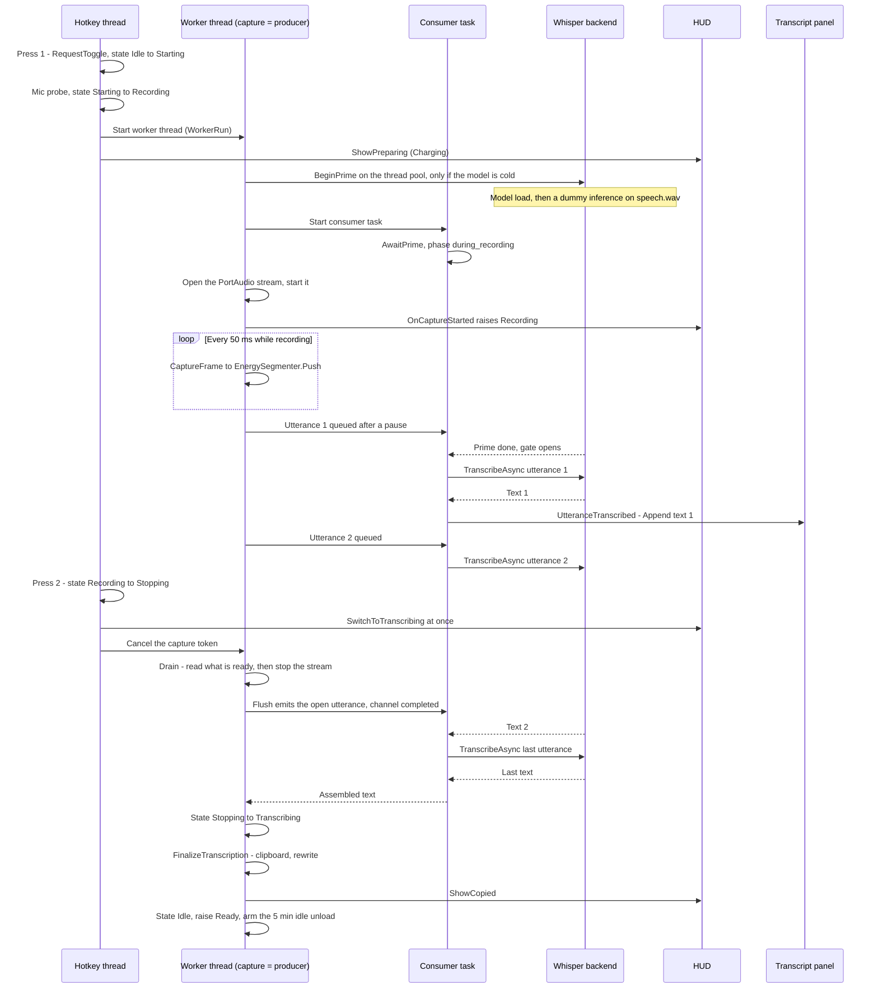
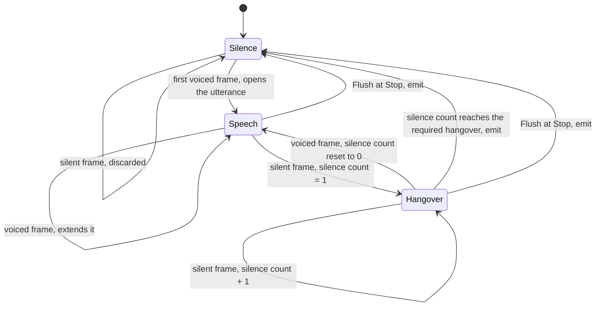

# The dictation chain

This note follows one dictation through Deckle, from the hotkey press to the text in the clipboard. It names each step, the file that does it, and the settings that change it. It is written to be read before the listening tests, so that a result can be traced back to a step and a parameter.

## How to read this note

Three markers tell you how solid each statement is.

- **Established**: read in the code. The file is named next to the statement. Most sentences in this note are of this kind, so they carry no extra marker.
- **Reading:** a paragraph that starts with this word is my interpretation of the code. It is likely, not proven.
- **Unverified**: something only running the app could show. The code alone cannot settle it.

Paths are relative to the repository root.

## Vocabulary

Most terms are defined in the module vocabularies. This list gives one line each and points to the file that owns the term.

- **Streaming** is the value `PipelineStrategyKind.Streaming` in `src/Deckle.Transcription/TranscriptionSettings.cs`. It is the pipeline that cuts the dictation into utterances while you speak and transcribes each one as soon as it ends. The text of each utterance then appears in the live transcript panel beside the HUD; there is no word-by-word display inside an utterance.
- **Monolithic** is the other value of the same enum. It captures the whole take, then makes one transcription call at the end.
- The code default is Streaming, and the comment above the enum says the monolithic path "is slated for removal once streaming proves out".
- **Utterance** vs **segment**: an utterance is the audio span Deckle cuts and sends to Whisper in one call; a segment is a piece of text Whisper returns inside that call. See `src/Deckle.Transcription/GLOSSARY.md`.
- **Neural VAD** vs **energy segmenter**: the neural VAD (Silero) is a model that finds speech inside one utterance the segmenter has already cut; the energy segmenter is a volume threshold that cuts the live stream. See `src/Deckle.Transcription/GLOSSARY.md`.
- **Hangover** vs **margin**: the hangover is how long the segmenter waits in silence before it decides an utterance has ended; the margin is how much of that silence it keeps at the end of the cut. See the header comment of `src/Deckle.Transcription/Streaming/EnergySegmenter.cs`.
- **Display level** vs **transcription pre-processing**: the display level only drives the HUD outline; pre-processing changes the audio sent to Whisper. See `src/Deckle.Audio/GLOSSARY.md`.
- **Dictation** vs **file transcription**: the two entry points into the same pipeline. See `src/Deckle.Transcription/GLOSSARY.md`.

## Diagram 1 — the chain, step by step

The main line is the Streaming path. The Monolithic path is the side branch at the strategy fork. Both end in the same finalize step.

Notes on the diagram:

- The hotkey is a toggle. The first press starts a take, the second press stops it. It is not push-to-talk (`RequestToggle` in `src/Deckle.Transcription/Engine/TranscriptionEngine.StateMachine.cs`).
- The fork is drawn after the frames for clarity. In the code, the strategy is chosen once per take in `WorkerRun`, before capture starts; the Monolithic path does not subscribe to frames.
- In Streaming, the pre-processing and the Silero trim run once per utterance, inside the consumer. In Monolithic, the pre-processing and then the Silero trim run once over the whole take, which the trim treats as one utterance (index 0 in its log lines) and cuts at its edges only, removing the leading and trailing silence and keeping the pauses inside: a take where it finds no speech is not dropped, it goes to the backend untrimmed and unpadded, whose own no-speech filter judges it, so a take with nothing in it ends with `no_text` as in Streaming. The Silero model is made ready before the capture starts, so its loading stays off the Stop→text path (`src/Deckle.Transcription/Engine/TranscriptionEngine.MonolithicPipeline.cs`; the trim helpers `PrepareSpeechTrim`, `TrimSpeech` (the consumer's) and `TrimSpeechEdges` (the monolithic take's) live in `src/Deckle.Transcription/Engine/TranscriptionEngine.StreamingPipeline.cs`).
- The phantom filter belongs to the consumer, so it runs for every take that goes through the segmented session: a live Streaming dictation, a file transcription and an audio recovery. The Monolithic path does not run it. The noise pad runs in both: in the consumer for each utterance, and in Monolithic after a successful trim of the take, on the backend buffer only (`src/Deckle.Transcription/Engine/TranscriptionEngine.StreamingPipeline.cs`, `src/Deckle.Transcription/Engine/TranscriptionEngine.MonolithicPipeline.cs`).
- File transcription is the second entry point: a tray command decodes an audio file and pushes its frames into the same energy segmenter, channel and consumer, then writes the text beside the file (`src/Deckle.Transcription/GLOSSARY.md`, `src/Deckle.Transcription/Engine/TranscriptionEngine.FilePipeline.cs`). It is left out of the diagrams.
- Audio recovery is a third way into the same consumer, used at launch when a take died before it was delivered. The audio the take left on disk is decoded to samples and pushed through `StartSegmentedTranscription` like a file, with the dictation's initial prompt and `ApplyPreprocessing` set to true (the pre-processing still applies only if `Preprocessing.Enabled` is on). Unlike a live take it rejects an incomplete result (`RejectIncompleteResults`): a skipped utterance would leave holes in the text, so the run fails and the audio is kept for the next launch. It delivers the raw text to the clipboard, never a rewrite (`src/Deckle.Transcription/Engine/TranscriptionEngine.AudioRecovery.cs` → `RecoverTakeFromAudioAsync`, launch-time decision in `src/Deckle.Transcription/Recovery/TakeAudioRecovery.cs`). It is left out of the diagrams.

### Node → file

| Node | File (→ member) | What it does |
|---|---|---|
| Hotkey press | `src/Deckle.App/App.Hotkeys.cs` → `ToggleRecordingFromHotkey` → `_engine.RequestToggle`; `src/Deckle.Transcription/Engine/TranscriptionEngine.StateMachine.cs` → `RequestToggle` | The chord is `HotkeysSettings.Record` in `src/Deckle.Settings/Persistence/AppSettings.cs`: Win + the key left of 1 (scan code `0x29`) by default, editable in Settings ▸ Shortcuts. The Record button of the tray panel lands on the same method. The press carries no rewrite profile: the active profile applies at finalize. A press while Idle starts; a press while Recording stops; any other state ignores the press. |
| Mic probe | `src/Deckle.Transcription/Engine/TranscriptionEngine.StateMachine.cs` → `TryStartFromIdleLocked` (`_capture.Probe`) | Checks the microphone before anything else. On failure, an error is shown and no take starts. Then the worker thread starts at AboveNormal priority. |
| PortAudio capture | `src/Deckle.Audio/MicrophoneCapture.cs` → `Record`; `src/Deckle.Audio/Internal/PortAudioEndpointProvider.cs` → `Open`, `OpenStream`; `src/Deckle.Audio/Internal/PortAudioCaptureEndpoint.cs`; `src/Deckle.Audio/Internal/PortAudioHost.cs` | Opens the microphone through PortAudio's WASAPI host API, in blocking mode (no callback), in the device's own format: float32 at its sample rate and channel count, so neither Windows nor PortAudio converts anything. The processing mode is the rawest the device gives: raw first, default as a fallback (logged as `CaptureModeFallback`). Exclusive access is tried first only when `CaptureSettings.ExclusiveMode` is on; the order is then exclusive raw, exclusive default, shared raw, shared default. The mic probe opens it shared. `CaptureStarted` fires once the stream has started. |
| Capture loop and signal path | `src/Deckle.Audio/Internal/CaptureLoop.cs` → `Pump`; `src/Deckle.Audio/Internal/CapturePipeline.cs` → `Accept`; `src/Deckle.Audio/Internal/MonoConverter.cs`; `src/Deckle.Audio/Internal/StreamingResampler.cs` | The loop polls `Available()` and reads exactly the frames that are ready, sleeping `CaptureLoop.PollIntervalMs` (4 ms) when none are. Each read goes through the pipeline: mean of the channels (`MonoConverter`), then resampling to 16 kHz (`StreamingResampler`, a windowed-sinc filter written in Deckle's code, bypassed when the device is already at 16 kHz). No gain, filter or compressor sits on this path. |
| One CaptureFrame per 50 ms | `src/Deckle.Audio/Internal/SubWindowAssembler.cs` → `Push`; `src/Deckle.Audio/Internal/CapturePipeline.cs` → `OnWindow`; `src/Deckle.Audio/CaptureFrame.cs` | Cuts the 16 kHz mono stream into 50 ms frames of 800 samples, whatever the size of the device packets, computes the RMS (the average loudness) of each, and raises the `Frame` and `AudioLevel` events. The same pipeline runs the low-audio tracker described under the engine constants. |
| AudioLevel event | `src/Deckle.Audio/MicrophoneCapture.cs` → `AudioLevel`; `src/Deckle.App/App.Startup.Shell.cs` → `_engine.AudioLevel += _hudWindow.OnAudioLevel`; `src/Deckle.Audio/AudioLevelMapper.cs`; `src/Deckle.Hud/Chrono/HudChrono.Stroke.cs` | About 20 times per second, the RMS goes to the HUD, which maps it to the brightness of the outline. Display only. |
| Streaming.Strategy | `src/Deckle.Transcription/Engine/TranscriptionEngine.StateMachine.cs` → `WorkerRun` | Reads the strategy from the live settings at each take, so a change applies to the next dictation without restart. |
| EnergySegmenter.Push | `src/Deckle.Transcription/Streaming/EnergySegmenter.cs` → `Push`, `Flush`; called from `OnFrame` in `src/Deckle.Transcription/Engine/TranscriptionEngine.StreamingPipeline.cs` | Decides, frame by frame, whether you are speaking, pausing, or done. Runs on the capture thread. Detailed in the next section. |
| Utterance queued | `src/Deckle.Transcription/Streaming/SegmentedTranscriptionSession.cs` → `Channel.CreateUnbounded`; `src/Deckle.Transcription/Streaming/Utterance.cs` | Hands each finished utterance to the consumer. One writer, one reader, no size limit, plus a `Backlog` counter. |
| Consumer task | `src/Deckle.Transcription/Engine/TranscriptionEngine.StreamingPipeline.cs` → `ConsumeUtterancesAsync` | Takes utterances one by one, in order, and is the only caller of Whisper at a time. Waits at `AwaitPrime` before its first call. |
| Optional pre-processing | `src/Deckle.Audio/Preprocessing/TranscriptionPreprocessor.cs` → `Process`; `src/Deckle.Audio/Preprocessing/PreprocessingSettings.cs` | Off by default. When on: high-pass filter, noise gate (off), compressor, makeup gain to a target level in two passes, limiter. Works on a copy of the audio. |
| Optional Silero trim | `src/Deckle.Vad/VadService.cs` → `EnsureReady`; `src/Deckle.Vad/SileroVad.cs` → `Trim` (Streaming), `DetectSpeech` (Monolithic); `src/Deckle.Vad/SileroSpeechTimestamps.cs` | On by default. Keeps only the speech inside the utterance. If no speech is found, the utterance is dropped. In Monolithic the trim removes the leading and trailing silence only (`TrimSpeechEdges`), and a take with no speech found goes to the backend untrimmed. If the model file is missing, it starts a background download and this take runs untrimmed. |
| Trailing noise pad | `src/Deckle.Transcription/Engine/TrailingNoisePad.cs` → `Append`; called in `ConsumeUtterancesAsync`, and in `ProduceMonolithicAsync` after a successful trim | Always on, not a setting. Appends 500 ms of fixed-seed uniform noise at about −60 dBFS RMS to the audio the backend receives. Replayed on the same audio, digital silence right behind the last word sometimes made Whisper end the text early; noise did not (the file's header gives 8 of 8 against 3 of 8 for the endings). The pad goes to the backend only: the corpus copy (`BackendAudio`) and the phantom filter's duration stay unpadded. With the default corpus content (`AudioCorpusContent.MatchTranscription`), that copy is what the backend received, so in Monolithic it is the take trimmed at its edges; a measurement that needs the whole take, such as the voice-level replay, sets the corpus content to `AlwaysRaw`. |
| WhisperBackend.TranscribeAsync | `src/Deckle.Transcription.Whisper/WhisperBackend.Transcribe.cs` → `TranscribeSync`; `src/Deckle.Transcription.Whisper/Engine/WhisperParamsMapper.cs` → `Apply` | One `whisper_full` call per utterance. The prompt is the fixed `InitialPrompt` plus the last 30 words of the previous utterance (`BuildPriming`, `TailOf`, `PrimingTailWords`). Whisper's own VAD is forced off (`wparams.vad = 0`). |
| Phantom filter | `src/Deckle.Transcription/Engine/PhantomUtteranceFilter.cs` → `Evaluate`; called in `ConsumeUtterancesAsync` | Judges the decoded text of an utterance, not its audio. Only an utterance of less than 1 s of audio (before the pad) can be rejected. It is rejected when it holds more than 12 text tokens per second (`token_rate`), or when its average token probability is under 0.7 and its weakest token under 0.1 (`low_confidence`). A result that reports no text tokens is kept. A rejected utterance contributes no text, its tail is not carried into the next prompt, and `UtterancePhantomRejected` is logged. |
| Text assembly | `src/Deckle.Transcription/Engine/TranscriptionEngine.StreamingPipeline.cs` → `pendingParagraphBreak = u.EndedOnSilence` | Joins the texts. After an utterance that ended on a silence, the next text starts a new paragraph (`\n\n`); otherwise a space. Only the last utterance of a take can end without a silence (the Flush at Stop), so in a dictation the texts are joined by paragraph breaks. See "The paragraph rule" below. |
| Monolithic | `src/Deckle.Transcription/Engine/TranscriptionEngine.MonolithicPipeline.cs` → `ProduceMonolithicAsync`; `src/Deckle.Transcription/Engine/TranscriptionEngine.Pipeline.cs` → `ConsumeMonolithicAudioAsync` | Captures the whole take, waits for the prime after Stop, runs the pre-processing once, then the Silero trim once (a take where it finds no speech goes on untrimmed), appends the noise pad after a successful trim, makes one backend call. Whisper then cuts its own 30 s windows inside that call. |
| FinalizeTranscription | `src/Deckle.Transcription/Engine/TranscriptionEngine.Finalize.cs` → `FinalizeTranscription`, `CopyToClipboard`, `DeliverTranscript`; `src/Deckle.Transcription/Engine/TranscriptionEngine.Finalize.Rewrite.cs` → `ApplyRewrite` | Copies the take as it reads at Stop to the clipboard first: the raw text, or the passages a streaming step already rewrote with the rest as said. Then, if a step at Stop applies, rewrites the whole text. Nothing is pasted: the clipboard copy is the delivery, and the HUD says it was copied. |
| HUD states | `src/Deckle.App/App.Startup.Shell.cs` → `StatusChanged` handler; `src/Deckle.App/App.Hotkeys.cs` → `ShowPreparing`, `SwitchToTranscribing`; `src/Deckle.Hud/Model/HudState.cs`; `src/Deckle.Hud/Windows/HudWindow.State.cs` | Start press → Charging. "Recording" status → Recording. Stop press → Transcribing at once. "Rewriting…" status → Rewriting. |
| ShowCopied | `src/Deckle.App/App.Startup.Shell.cs` → `TranscriptionFinished` handler | ClipboardOnly → the "copied" message. No text → the HUD hides. |
| Transcript panel | `src/Deckle.Transcription/Engine/TranscriptionEngine.StreamingPipeline.cs` → `RaiseTranscriptChanged` (event `TranscriptChanged` declared in `src/Deckle.Transcription/Engine/TranscriptionEngine.Utterances.cs`, snapshot in `src/Deckle.Transcription/Streaming/TranscriptSnapshot.cs`); `src/Deckle.App/App.TranscriptPanel.cs`; `src/Deckle.Hud/Transcript/TranscriptPanelWindow.xaml.cs` | The engine raises a `TranscriptSnapshot`, the whole text of the take as it would be delivered at that moment, after each utterance that yields text (`Appended`), after each passage rewrite that changes what the take reads during the recording (`Revised`, `TranscriptionEngine.BatchRewrite.cs` → `FeedStreamingRewrite`, text from the take's `DictationDocument.Snapshot`) and when the whole-take rewrite replaces the raw text at finalize (`Revised`, `TranscriptionEngine.Finalize.cs`). The panel shows the snapshot as is, it assembles nothing: what it shows is what the clipboard gets. A revision cross-fades the text; an append lays out the longer text. The panel opens a take when the engine starts recording, closes it when the transcription finishes, hides with the HUD and comes back with it, beside "Copied". With the HUD turned off (`Overlay.Enabled`), no take opens. Its side is `Overlay.TranscriptPanelSide` (Settings ▸ Transcription). Monolithic raises no snapshot before finalize, so the panel stays hidden there. `UtteranceTranscribed` still fires per utterance for the feeds that need the unit (batch rewriter, recovery file). |

## Diagram 2 — one Streaming take over time

This diagram shows who does what, and when. The key point is that utterances are transcribed while you are still speaking, so at Stop only the last ones remain.

Notes on the diagram:

- On a warm model (used in the last 5 minutes), `BeginPrime` returns a finished task at once, and the consumer does not wait.
- On a cold model, the first utterances wait in the channel until the prime is done. The wait is hidden behind the recording, which is why its phase is named `during_recording` (`ConsumeUtterancesAsync`). In Monolithic the same wait happens after Stop and is named `at_stop`.
- The prime survives a Stop: it uses the drain token, which only Dispose cancels (`BeginPrime` in `src/Deckle.Transcription/Engine/TranscriptionEngine.Lifecycle.cs`).
- Reading: the two Whisper calls never overlap. The consumer is a sequential loop, the prime gate orders the first call after the dummy one, and `_transcribeLock` in `src/Deckle.Transcription.Whisper/WhisperBackend.Transcribe.cs` serialises native calls anyway.
- The engine state stays Stopping while the consumer drains the backlog. It moves to Transcribing only once the text is assembled. The HUD already shows Transcribing since the second press (`src/Deckle.App/App.Hotkeys.cs`).

### Node → file

| Step | File (→ member) |
|---|---|
| Press 1, Idle → Starting → Recording | `src/Deckle.Transcription/Engine/TranscriptionEngine.StateMachine.cs` → `RequestToggle`, `TryStartFromIdleLocked`; states in `src/Deckle.Transcription/Engine/TranscriptionEngine.cs` → `PipelineState` |
| ShowPreparing (Charging) | `src/Deckle.App/App.Hotkeys.cs` → `ToggleResult.Started`; `src/Deckle.Hud/Windows/HudWindow.State.cs` → `ShowPreparing` |
| Worker thread | `src/Deckle.Transcription/Engine/TranscriptionEngine.StateMachine.cs` → `WorkerRun` (`ThreadPriority.AboveNormal`) |
| BeginPrime, dummy inference | `src/Deckle.Transcription/Engine/TranscriptionEngine.Lifecycle.cs` → `BeginPrime`, `EnsurePrimed`, `TryLoadWarmupClip` (reads `Assets/Sounds/speech.wav` next to the exe) |
| Consumer task, AwaitPrime | `src/Deckle.Transcription/Engine/TranscriptionEngine.StreamingPipeline.cs` → `StartSegmentedTranscription`, `ConsumeUtterancesAsync`; `src/Deckle.Transcription/Engine/TranscriptionEngine.Lifecycle.cs` → `AwaitPrime` |
| Stream start, Recording | `src/Deckle.Audio/MicrophoneCapture.cs` → `Record` (`endpoint.Start`, then `CaptureStarted`); `src/Deckle.Transcription/Engine/TranscriptionEngine.StateMachine.cs` → `OnCaptureStarted` |
| Frames to the segmenter | `src/Deckle.Transcription/Engine/TranscriptionEngine.StreamingPipeline.cs` → `ProduceStreamingAsync` (`OnFrame`); `src/Deckle.Transcription/Streaming/SegmentedTranscriptionSession.cs` → `Push` |
| Utterance queued | `src/Deckle.Transcription/Streaming/EnergySegmenter.cs` → `EmitOnSilence`; `src/Deckle.Transcription/Streaming/SegmentedTranscriptionSession.cs` → `TryWrite` |
| TranscribeAsync | `src/Deckle.Transcription.Whisper/WhisperBackend.Transcribe.cs` → `TranscribeAsync` |
| UtteranceTranscribed, Append | `src/Deckle.Transcription/Engine/TranscriptionEngine.StreamingPipeline.cs` → `ConsumeUtterancesAsync`; `src/Deckle.App/App.TranscriptPanel.cs`; `src/Deckle.Hud/Transcript/TranscriptPanelWindow.xaml.cs` → `Append` |
| Press 2, Recording → Stopping | `src/Deckle.Transcription/Engine/TranscriptionEngine.StateMachine.cs` → `RequestToggle` (`_recordCts.Cancel`) |
| SwitchToTranscribing at once | `src/Deckle.App/App.Hotkeys.cs` → `ToggleResult.Stopped` |
| Drain | `src/Deckle.Audio/Internal/CaptureLoop.cs` → `Pump` (after the loop: a last `DrainReady`, then `endpoint.Stop()`, then `pipeline.Finish`) |
| Flush, channel completed | `src/Deckle.Transcription/Streaming/SegmentedTranscriptionSession.cs` → `Complete`; `src/Deckle.Transcription/Streaming/EnergySegmenter.cs` → `Flush` |
| Stopping → Transcribing | `src/Deckle.Transcription/Engine/TranscriptionEngine.StreamingPipeline.cs` → `ProduceStreamingAsync` (CAS after `session.Completion`) |
| Finalize | `src/Deckle.Transcription/Engine/TranscriptionEngine.Finalize.cs` → `FinalizeTranscription` |
| ShowCopied | `src/Deckle.App/App.Startup.Shell.cs` → `TranscriptionFinished` handler |
| Idle, Ready, idle unload | `src/Deckle.Transcription/Engine/TranscriptionEngine.StateMachine.cs` → `SettleWorkerToIdle`; `src/Deckle.Transcription/Engine/TranscriptionEngine.Lifecycle.cs` → `ResetIdleTimer`, `UnloadModel`; `MODEL_IDLE_TIMEOUT_MS` in `src/Deckle.Transcription/Engine/TranscriptionEngine.cs` |

## Parameters

Where the files live:

- Transcription settings are stored in `<UserDataRoot>/modules/transcription/settings.json` (comment at the top of `src/Deckle.Transcription/TranscriptionSettings.cs`).
- Every settings file writes its keys in camelCase (`JsonNamingPolicy.CamelCase` in `src/Deckle.Transcription/TranscriptionSettingsService.cs`, `src/Deckle.Audio/CaptureSettingsService.cs` and `src/Deckle.Settings/Persistence/SettingsService.cs`). The section column below uses those keys.
- Audio settings are stored in `<UserDataRoot>/modules/audio/settings.json` (`src/Deckle.Audio/CaptureSettingsService.cs`). The file holds `CaptureSettings` at its root.
- `<UserDataRoot>` is `%LOCALAPPDATA%\Deckle`, unless the `DECKLE_DATA_ROOT` environment variable is set (`src/Deckle.Core/Paths/AppPaths.cs`).

Where the settings are shown:

- **Settings ▸ Transcription**: `src/Deckle.Transcription.Views/WhisperPage.xaml` and `src/Deckle.Transcription.Views/WhisperPage.xaml.cs` (the hand-written cards: model, language, initial prompt), plus the composed GPU and models-folder cards of `src/Deckle.Transcription.Views/ViewModels/WhisperViewModel.Settings.cs`. The two pages below are nested under it in the rail.
- **Settings ▸ Decoding** (`src/Deckle.Transcription.Views/DecodingPage.xaml`): the decoding, confidence, context and output-filter cards, composed in `WhisperViewModel.Settings.cs`.
- **Settings ▸ Streaming** (`src/Deckle.Transcription.Views/StreamingPage.xaml`): the streaming toggle, the Silero (VAD) group and the energy segmenter cards, including the cut curve card with its anchors and the curve editor `src/Deckle.Catalog/Composer/CurveEditor.cs` (no preset selector), composed in `WhisperViewModel.Settings.cs`.
- **Settings ▸ Recording**: `src/Deckle.Audio.Views/RecordingViewModel.Settings.cs`, plus the microphone picker in `src/Deckle.Audio.Views/RecordingPage.xaml.cs`.

### Transcription module — `modules/transcription/settings.json`

| Parameter | Acts in | Default in code | Stored in (section) | Exposed where |
|---|---|---|---|---|
| `Engine.Model` | `src/Deckle.Transcription.Whisper/WhisperBackend.Model.cs` (model load) | `"ggml-base.bin"` | `engine` | Transcription (model card, `WhisperPage.xaml`) |
| `Engine.UseGpu` | `src/Deckle.Transcription.Whisper/Engine/WhisperContextParamsMapper.cs` (model load) | `true` | `engine` | Transcription (`WhisperUseGpuCard`) |
| `Engine.Language` | `src/Deckle.Transcription.Whisper/Engine/WhisperParamsMapper.cs` | `"fr"` | `engine` | Transcription (`WhisperPage.xaml.cs`) |
| `Engine.InitialPrompt` | `src/Deckle.Transcription.Whisper/Engine/WhisperParamsMapper.cs`; in Streaming, the fixed part of every prompt (`ProduceStreamingAsync`) | A French paragraph about coding a Windows app (see the file) | `engine` | Transcription (`WhisperInitialPromptCard`) |
| `Engine.CarryInitialPrompt` | `src/Deckle.Transcription.Whisper/Engine/WhisperParamsMapper.cs` | `true` | `engine` | Not exposed |
| `Confidence.EntropyThreshold` | `src/Deckle.Transcription.Whisper/Engine/WhisperParamsMapper.cs` | `2.4` | `confidence` | Decoding page (Confidence section, `WhisperEntropyCard`) |
| `Confidence.LogprobThreshold` | same | `-1.0` | `confidence` | Decoding page (Confidence section, `WhisperLogprobCard`) |
| `Confidence.NoSpeechThreshold` | same | `0.6` | `confidence` | Decoding page (Confidence section, `WhisperNoSpeechCard`) |
| `Decoding.Temperature` | same | `0.0` | `decoding` | Decoding page (Decoding section, `WhisperTemperatureCard`) |
| `Decoding.TemperatureIncrement` | same | `0.2` | `decoding` | Decoding page (Decoding section, `WhisperTemperatureIncrementCard`) |
| `Decoding.UseBeamSearch` | same | `true` | `decoding` | Decoding page (Decoding section, `WhisperUseBeamSearchCard`) |
| `Decoding.BeamSize` | same | `5` | `decoding` | Decoding page (Decoding section, `WhisperBeamSizeCard`, visible when beam search is on) |
| `Context.UseContext` | same (`no_context`) | `true` | `context` | Decoding page (Context section, `WhisperUseContextCard`) |
| `Context.MaxTokens` | same (`n_max_text_ctx`) | `-1` (auto) | `context` | Decoding page (Context section, `WhisperMaxTokensCard`) |
| `OutputFilters.SuppressNonSpeechTokens` | same | `true` | `outputFilters` | Decoding page (Output filters section, `WhisperSuppressNstCard`) |
| `OutputFilters.SuppressBlank` | same | `true` | `outputFilters` | Decoding page (Output filters section, `WhisperSuppressBlankCard`) |
| `OutputFilters.SuppressRegex` | same | `""` | `outputFilters` | Decoding page (Output filters section, `WhisperSuppressRegexCard`) |
| `Streaming.Strategy` | `src/Deckle.Transcription/Engine/TranscriptionEngine.StateMachine.cs` → `WorkerRun` | `Streaming` | `streaming` | Streaming page (`WhisperStreamingEnabledCard` toggle: on = Streaming) |
| `Streaming.Segmenter.HangoverMaxMs` | same | `5000` | `streaming.segmenter` | Streaming page (cut curve card, legend field "Max wait", ms) |
| `Streaming.Segmenter.HangoverMinMs` | same | `1000` | `streaming.segmenter` | Streaming page (cut curve card, legend field "Min wait", ms) |
| `Streaming.Segmenter.HangoverRampStartMs` | same | `15000` | `streaming.segmenter` | Streaming page (cut curve card, legend field "Ramp start", ms) |
| `Streaming.Segmenter.HangoverRampEndMs` | same | `120000` | `streaming.segmenter` | Streaming page (cut curve card, legend field "Ramp end", ms) |
| `Streaming.Segmenter.HangoverCurveX1` | same (via `src/Deckle.Transcription/Curves/UnitBezier.cs`) | `0.85` | `streaming.segmenter` | Streaming page (cut curve card, full-width editor, `WhisperCutCurveCard`) |
| `Streaming.Segmenter.HangoverCurveY1` | same | `0.10` | `streaming.segmenter` | Streaming page (cut curve card) |
| `Streaming.Segmenter.HangoverCurveX2` | same | `0.90` | `streaming.segmenter` | Streaming page (cut curve card) |
| `Streaming.Segmenter.HangoverCurveY2` | same | `0.25` | `streaming.segmenter` | Streaming page (cut curve card) |
| `Streaming.Segmenter.MarginMs` | same | `150` | `streaming.segmenter` | Streaming page (`WhisperSegMarginCard`, the cut curve's pause strip, seconds) |
| `Streaming.MinSpeechMs` | `src/Deckle.Transcription/Streaming/EnergySegmenter.cs` (the floor on an utterance's voiced extent) and `src/Deckle.Vad/SileroSpeechTimestamps.cs` (via `SileroVadOptions.MinSpeechDurationMs`, the floor on each speech span) | `250` | `streaming` | Streaming page (`WhisperMinSpeechCard`, the cut curve's pause strip, seconds) |
| `Streaming.SpeechTrim.Enabled` | `src/Deckle.Transcription/Engine/TranscriptionEngine.StreamingPipeline.cs` → `PrepareSpeechTrim`, called by `StartSegmentedTranscription` and `ProduceMonolithicAsync` | `true` | `streaming.speechTrim` | Streaming page (`WhisperVadEnabledCard`, the VAD group's switch, visible whatever the strategy) |
| `Streaming.SpeechTrim.Threshold` | `src/Deckle.Vad/SileroSpeechTimestamps.cs` (via `src/Deckle.Vad/SileroVadOptions.cs`) | `0.5` | `streaming.speechTrim` | Streaming page (`WhisperVadThresholdCard`, child of the VAD group, shown while the group is on) |
| `Streaming.SpeechTrim.MinSilenceDurationMs` | same | `100` | `streaming.speechTrim` | Streaming page (`WhisperVadMinSilenceCard`, child of the VAD group) |
| `Streaming.SpeechTrim.SpeechPadMs` | same | `30` | `streaming.speechTrim` | Streaming page (`WhisperVadSpeechPadCard`, child of the VAD group) |

On the Streaming page, everything under the Streaming switch shows whatever the switch says: the switch picks only the dictation pipeline, and files and recovered takes are always cut and trimmed with these settings. Speech filtering comes first: the VAD group, its switch and its three children (detector confidence, minimum silence, padding), the children hidden while the group is off. Segmentation follows: the margin and minimum speech cards (the minimum speech sits here, not in the VAD group, because it is the only guard left when Silero is off or its model is missing), then the cut curve card at full width, whose legend carries the four hangover anchors (Max wait, Min wait, Ramp start, Ramp end, in ms) beside the curve editor over the four control points.

### Audio module — `modules/audio/settings.json`

| Parameter | Acts in | Default in code | Stored in (section) | Exposed where |
|---|---|---|---|---|
| `AudioInputEndpointId` | `src/Deckle.Audio/MicrophoneCapture.cs` (`Probe`, `Record`), resolved in `src/Deckle.Audio/Internal/PortAudioEndpointProvider.cs` | `""` (system default device, resolved at each take); replaces the former waveIn index `AudioInputDeviceId`, which `src/Deckle.Audio/CaptureSettingsService.cs` migrates (schema version 2) | root | Recording (microphone picker, `RecordingPage.xaml.cs`) |
| `VoiceLevelDbfs` | `src/Deckle.Audio/VoiceDetector.cs`, run by `src/Deckle.Transcription/Streaming/EnergySegmenter.cs` and the low-audio tracker in `src/Deckle.Audio/Internal/LowAudioTracker.cs`; `src/Deckle.Audio/AudioLevelMapper.cs` anchors the HUD outline on it | `-45.0`, kept in the audio module's settings | root | Recording (`RecordingVoiceLevelCard`, "Voice level", magnitude field in dBFS, with the voice meter under it) |
| `ExclusiveMode` | `src/Deckle.Audio/Internal/PortAudioEndpointProvider.cs` → `Open` (`options.Exclusive` adds the two exclusive attempts before the shared ones); read by `MicrophoneCapture.Record` | `false`; a refused exclusive open falls back to shared and is logged | root | Recording (`RecordingExclusiveModeCard`, toggle) |
| `MaxRecordingDurationSeconds` | `src/Deckle.Audio/Internal/CaptureLoop.cs` (cap check, skipped at 0) | `0` (no limit); a file still holding the former 20 min default is migrated to 0 (`src/Deckle.Audio/CaptureSettingsService.cs`) | root | Recording (`RecordingLimitCard`, "Maximum recording length": No limit, 10, 20, 30 min, 1 h, 2 h) |
| `Preprocessing.Enabled` | `src/Deckle.Audio/Preprocessing/TranscriptionPreprocessor.cs` | `false` | `preprocessing` | Recording (`RecordingPagePreprocessingCard`) |
| `Preprocessing.HighPassEnabled`, `HighPassHz` | same | `true`, `90` Hz | `preprocessing` | Not exposed |
| `Preprocessing.GateEnabled`, `GateThresholdDbfs`, `GateRatio`, `GateAttackMs`, `GateReleaseMs` | same | `false`, `-55`, `2`, `5`, `150` | `preprocessing` | Not exposed |
| `Preprocessing.CompressorEnabled`, `CompThresholdDbfs`, `CompRatio`, `CompKneeDb`, `CompAttackMs`, `CompReleaseMs` | same | `true`, `-24`, `2`, `6`, `8`, `150` | `preprocessing` | Not exposed |
| `Preprocessing.TargetRmsDbfs`, `MaxMakeupGainDb` | same | `-20`, `24` | `preprocessing` | Not exposed |
| `Preprocessing.LimiterEnabled`, `LimiterCeilingDbfs`, `LimiterReleaseMs` | same | `true`, `-1`, `50` | `preprocessing` | Not exposed |

The pre-processing has 18 fixed fields after `Enabled`: four stage switches and fourteen values. `PreprocessingSettings.cs` says they are "an engineer's starting point, NOT measured optima". No Settings card and no Playground page edits them.

The HUD outline's level window is no longer a setting of its own: `src/Deckle.Audio/AudioLevelMapper.cs` anchors it on the voice level, dark at the level and full 20 dB above it, through a square-root curve. The former `LevelWindow` section and its auto-calibration were removed on 2026-11-06, since they had never been persisted (the class used public fields, which System.Text.Json ignores by default; see `docs/research/research--seuils-voix--2026-11-06.md`).

Under the Voice level card, the Recording page carries the voice meter (`src/Deckle.Audio.Views/VoiceLevelMeter.xaml`): Listen opens the configured microphone with nothing kept (`RetainsAudio` off, purpose `voice_meter` in the log) and draws the live level on a fixed −80 to −10 dBFS track, with the voice level marked (and the detector's entry level beside it when the entry margin is positive; with the default margin of 0 the two coincide and only the voice level is drawn), the fill in the accent while its own `VoiceDetector` says voiced. It shows and never writes; the marks follow the field as it is edited. The microphone level check under Checks also says how far the measured level sits above or below the voice level.

### Constants in the engine, not stored

| Constant | Where | Value | Exposed |
|---|---|---|---|
| `PrimingTailWords` | `src/Deckle.Transcription/Engine/TranscriptionEngine.StreamingPipeline.cs` | `30` words of the previous utterance added to the prompt | No |
| `MODEL_IDLE_TIMEOUT_MS` | `src/Deckle.Transcription/Engine/TranscriptionEngine.cs` | `5 * 60 * 1000` (5 min) before the model is freed | No |
| `PollIntervalMs` | `src/Deckle.Audio/Internal/CaptureLoop.cs` | `4` ms of sleep when the device has no frame ready | No |
| `LagThresholdMs` | `src/Deckle.Audio/Internal/CaptureLoop.cs` | `60` ms: audio found waiting at one wake that counts as the loop having fallen behind (`CaptureLagDetected`) | No |
| `WindowMs`, `WindowSamples` | `src/Deckle.Audio/Internal/SubWindowAssembler.cs` | `50` ms, 800 samples at 16 kHz | No |
| `FrameMs` | `src/Deckle.Transcription/Streaming/EnergySegmenter.cs` | `50` ms; every segmenter duration is rounded to whole frames | No |
| Low-audio warning: `NormalVoiceSustainedMs`, `WarnAfterSilenceMs` | `src/Deckle.Audio/Internal/LowAudioTracker.cs` (fed one 50 ms frame at a time by `CapturePipeline`; only a take that retains audio has one) | If the first 5 s of a take never contain 200 ms in a row that a `VoiceDetector` on the voice level calls voiced, the capture raises `LowAudioDetected` once, and `OnCaptureLowAudioDetected` in `src/Deckle.Transcription/Engine/TranscriptionEngine.cs` shows the `Engine_LowAudio_Title` / `Engine_LowAudio_Body` overlay | No |

### Louis's own values

Louis reports that he runs the Streaming strategy with the segmenter threshold (now the voice level) at −38 dBFS. Both values live in his own `settings.json`, outside the repository, so this note cannot establish them. The code default strategy is Streaming as well; the code default voice level is −45 dBFS.

## Latencies

### What the code measures for each take

At the end of each take, `RecordPipelineMetrics` emits the `PipelineTimings` event (`src/Deckle.Transcription/Engine/TranscriptionEngine.Finalize.Observability.cs`). The table lists its timings. The rewrite sub-timings travel in a separate event, `PipelineLlmMetrics`, emitted in the same file; they are left out here because they belong to the rewrite.

| Field | Start → end | Where it is measured |
|---|---|---|
| `model_load_ms` | Model load, cold takes only; 0 when warm | `LoadModel` in `src/Deckle.Transcription/Engine/TranscriptionEngine.Lifecycle.cs` |
| `hotkey_to_capture_ms` | Start press → stream started (`CaptureStarted`) | `_hotkeySw`, started in `TryStartFromIdleLocked`, stopped in `OnCaptureStarted` |
| `record_drain_ms` | Loop leaves → last ready frames read, stream stopped, resampler flushed | `DrainDuration`, measured in `CaptureLoop.Pump` (`src/Deckle.Audio/Internal/CaptureLoop.cs`) |
| `stop_to_pipeline_ms` | Stop press → Streaming: consumer finished draining; Monolithic: handoff to the backend | `_stopToPipelineSw`, started in `RequestToggle`, stopped in `ProduceStreamingAsync` or `ProduceMonolithicAsync` |
| `whisper_init_ms` | The init stopwatch, summed over all utterances. It starts just before `whisper_full` and stops at the first `encoder_begin_callback`, so it times whisper.cpp's pre-decode setup (mel spectrogram, VAD when enabled, state reset). A call that never reaches the encoder stops it when `whisper_full` returns | `InitDurationMs` of each `TranscriptionResult` (`_whisperInitSw` in `src/Deckle.Transcription.Whisper/WhisperBackend.Transcribe.cs`) |
| `whisper_ms` | Whisper's total time minus `whisper_init_ms`, summed over all utterances: the encode and decode | same |
| `llm_ms` | Ollama rewrite, 0 without a profile | `src/Deckle.Transcription/Engine/TranscriptionEngine.Finalize.Rewrite.cs` |
| `clipboard_ms` | Raw copy to the clipboard | `FinalizeTranscription` |

On a cold take, `AwaitPrime` also emits `PrimeOverlap` with the prime's own duration, the time the gate actually waited, and the phase (`during_recording` or `at_stop`) (`src/Deckle.Transcription/Engine/TranscriptionEngine.Lifecycle.cs`). It shows how much of the cold cost the recording hid.

Reading: in Streaming, `stop_to_pipeline_ms` is the delay you feel after the second press, minus finalize. It includes the drain and the transcription of whatever utterances were still queued.

`PipelineTimings` is part of the transcription summary: it is written to `diagnostics/log.jsonl` on every take, with no setting. The separate `latency.jsonl` file and its toggle were removed on 2026-11-13.

A code comment in `EnsurePrimed` says the dummy inference takes "~200–800 ms on RX 7900 XT with Vulkan ggml". That is a comment, not a measurement this note can rely on.

### Delays built into the code

These are fixed by the code. They are not measured; they are the minimum or the step size of each stage.

| Delay | Value | Where |
|---|---|---|
| Capture frame | 50 ms (800 samples at 16 kHz) | `src/Deckle.Audio/Internal/SubWindowAssembler.cs` |
| Device period | set by the device; the code comment gives 10 ms on a shared WASAPI stream. The stream's input latency is reported by PortAudio and logged at the start of the take | `src/Deckle.Audio/Internal/PortAudioEndpointProvider.cs` (`SuggestedLatency`, `InputLatency`), `src/Deckle.Audio/Internal/CaptureLoop.cs` (header comment) |
| Capture poll | `Available()` is asked, and the loop sleeps 4 ms when nothing is ready; the real wake can be later, since `Thread.Sleep` rounds up to the system timer | `CaptureLoop.PollIntervalMs` in `src/Deckle.Audio/Internal/CaptureLoop.cs` |
| Lag threshold | 60 ms of audio found waiting at one wake counts as the loop having fallen behind | `CaptureLoop.LagThresholdMs` in `src/Deckle.Audio/Internal/CaptureLoop.cs` |
| Drain after Stop | no fixed delay: the loop reads what is ready, then stops the stream; the duration is measured, not set | `src/Deckle.Audio/Internal/CaptureLoop.cs` → `Pump` |
| Margin | 150 ms of silence kept after the last voiced frame | `EnergySegmenterSettings.MarginMs` |
| Hangover | 1 s to 5 s of silence before a cut, depending on how long the utterance already is | `EnergySegmenterSettings.HangoverMinMs`, `HangoverMaxMs` |
| Heartbeat log | once per second (every 20 frames), only when verbose logging is on | `OnFrame` in `src/Deckle.Transcription/Engine/TranscriptionEngine.StreamingPipeline.cs` |
| Idle unload | model freed 5 min after the last take | `MODEL_IDLE_TIMEOUT_MS` in `src/Deckle.Transcription/Engine/TranscriptionEngine.cs` |

Reading: the hangover is the largest built-in delay. An utterance is handed to Whisper only once its trailing silence reaches the hangover. With the defaults, a sentence shorter than 15 s waits for 5 s of silence. The next section explains this.

## Segmentation

In Streaming, the energy segmenter decides where one utterance ends and the next begins. It listens to the volume only. It does not know what a word is. This section explains its rules, then what happens to an utterance after the cut.

### A frame and the voice level

A **frame** is one 50 ms slice of the microphone signal: 800 samples at 16 kHz, with its RMS, the average loudness of those samples on a linear scale from 0 to 1 (`src/Deckle.Audio/CaptureFrame.cs`). The segmenter receives one frame at a time, in order, and decides for each one whether it is **voiced** (loud enough to count as speech) or **silent**.

The segmenter does not compare the RMS itself: it asks its own `VoiceDetector` (`src/Deckle.Audio/VoiceDetector.cs`), built on the voice level (`VoiceLevelDbfs`, Recording page). The detector has two levels, turned from decibels into the linear scale once: `10^(dB / 20)`. The voice level is the **exit** level: a voiced run ends on the first frame below it. The **entry** level sits a margin above it (`DefaultEntryMarginDb`), and that margin is 0 by default, so the two coincide and the test is the plain level test it was before the detector. A positive margin, still to be sized against the audio corpus, would gate only the opening of an utterance from Silence: once an utterance is open, the segmenter asks the detector's `Resume` in Hangover, so the resume after a pause happens at the voice level, not at the entry. With the default −45 dBFS, the level is an RMS of about 0.0056. With −38 dBFS, the value Louis reports using, the exit is about 0.0126: a frame must be about twice as loud to count as speech.

Reading: a higher voice level (closer to 0) makes quiet breaths and room noise count as silence, so pauses are detected more easily; it also risks counting the soft end of a word as silence.

### Diagram 3 — the three states of the segmenter

How to read it:

- **Silence**: no utterance is open. Silent frames are thrown away. The first voiced frame opens a new utterance, and that frame is its first sample: nothing before it is kept.
- **Speech**: an utterance is open and the last frame was voiced. Every frame is added to it, voiced or silent.
- **Hangover**: an utterance is open, and the last frames were silent. The segmenter is not sure yet whether this is a short pause inside a sentence or the end. It counts the silent frames in a row. A voiced frame sets the count back to 0 and returns to Speech; voiced here means at or above the voice level (the detector's `Resume`), never the entry level, whatever the margin. When the count reaches the required hangover, the segmenter cuts and emits the utterance with `EndedOnSilence = true`.
- **Flush at Stop**: when you press the hotkey to stop, the open utterance is emitted whatever its state, with `EndedOnSilence = false`. In Silence, Flush does nothing.
- The step Speech → Hangover also checks the required hangover. With the defaults it never cuts there, because the minimum hangover is 10 frames. It only matters if a hangover rounds to one frame (under 75 ms: `FramesFromMs` uses `Math.Round`, which rounds 75 ms, 1.5 frames, to 2).
- The segmenter has no maximum utterance length. An utterance only ends on a silence long enough, or at Stop. The header of `EnergySegmenter.cs` says so ("No hard cap"). There is no "safety ceiling" in the code. The only cap is the optional capture limit (`MaxRecordingDurationSeconds`, off by default), which ends the whole take through the same Flush when the user has set one.

#### Node → file

| Node or transition | File (→ member) |
|---|---|
| Silence, Speech, Hangover | `src/Deckle.Transcription/Streaming/EnergySegmenter.cs` → `enum State` |
| Voiced or silent frame | same → `Push` (`_voice.Push(frame.Rms)`); the detector is `src/Deckle.Audio/VoiceDetector.cs`, built in the constructor on the voice level |
| Opens the utterance | same → `Push`, case `State.Silence` (`_utteranceStartFrame`, `_lastVoicedIdx = 0`) |
| Silence count | same → `_hangoverCount`, cases `State.Speech` and `State.Hangover` |
| Required hangover | same → `RequiredHangoverFrames`; curve in `src/Deckle.Transcription/Curves/UnitBezier.cs` → `Solve` |
| Emit on silence | same → `EmitOnSilence` → `EmitKept(endedOnSilence: true)` → `Emit` |
| Flush at Stop | same → `Flush` → `EmitKept(endedOnSilence: false)`; called by `src/Deckle.Transcription/Streaming/SegmentedTranscriptionSession.cs` → `Complete` |
| Back to Silence | same → `ResetToSilence` |
| Emitted utterance | `src/Deckle.Transcription/Streaming/Utterance.cs`; written to the channel in `SegmentedTranscriptionSession.cs` (constructor callback) |
| Live state in the logs | `EnergySegmenter.cs` → `Snapshot`; read by the 1 Hz heartbeat in `OnFrame` (`src/Deckle.Transcription/Engine/TranscriptionEngine.StreamingPipeline.cs`) |

### The hangover ramp

The required hangover is not fixed. It gets shorter as the open utterance gets longer, so that a long monologue is cut on shorter pauses than a short sentence (`RequiredHangoverFrames` in `src/Deckle.Transcription/Streaming/EnergySegmenter.cs`):

- While the open utterance is at or below `HangoverRampStartMs` (15 s), the required hangover is `HangoverMaxMs` (5 s).
- At or above `HangoverRampEndMs` (120 s), it is `HangoverMinMs` (1 s).
- In between, it goes from the maximum down to the minimum along a curve. The progress through the ramp (0 at its start, 1 at its end) goes into `UnitBezier.Solve`, which returns how far the delay has dropped (0 = still at the maximum, 1 = at the minimum). The curve is a cubic Bézier, the same function as CSS `cubic-bezier(x1, y1, x2, y2)`, with the control points `HangoverCurveX1`, `HangoverCurveY1`, `HangoverCurveX2`, `HangoverCurveY2` (`src/Deckle.Transcription/Curves/UnitBezier.cs`). The defaults (0.85, 0.10, 0.90, 0.25) keep the delay near the maximum for most of the ramp, then drop it late.

Three details from the code:

- Every duration is rounded to whole 50 ms frames once, in the constructor (`FramesFromMs`). 5000 ms is 100 frames, 1000 ms is 20 frames, 150 ms is 3 frames.
- If `HangoverMinMs` is set above `HangoverMaxMs`, the minimum is lowered to the maximum. If `HangoverRampEndMs` is set below `HangoverRampStartMs`, the end is raised to the start. So the delay can only stay the same or shrink as the utterance grows.
- The length that drives the ramp is the speech length: the frames up to the last voiced frame (`_lastVoicedIdx + 1`), frozen at the first silent frame. The silent frames of the pause are not counted, so the requirement does not shrink while a pause goes on: a late pause waits for the delay it showed when it began. (Before this was fixed the length included the pause frames, and a pause late in a long utterance cut sooner than the delay shown.)
- The pause gauge (`Progress.IsPausing`, `SilenceElapsedMs`) is debounced for display: it reports a pause only after 4 frames (200 ms) of continuous silence, so a 100 ms dip between syllables never flashes it. The hangover counter still starts at the first silent frame, so the cut falls at the same frame with or without the debounce.

Required hangover at a given utterance length, with the default values. **Computed from the code, not measured**: the values come from reproducing `UnitBezier.Solve` (Newton-Raphson, then bisection, precision 1e-6) and the rounding of `RequiredHangoverFrames`.

| Utterance length | Progress in the ramp | Curve output | Required hangover |
|---|---|---|---|
| 0 s | before the ramp | — | 100 frames = 5000 ms |
| 15 s | ramp start (included in the maximum) | — | 100 frames = 5000 ms |
| 30 s | 0.143 | 0.018 | 99 frames = 4950 ms |
| 60 s | 0.429 | 0.072 | 94 frames = 4700 ms |
| 90 s | 0.714 | 0.196 | 84 frames = 4200 ms |
| 120 s | ramp end | — | 20 frames = 1000 ms |

The drop is late, as the comment in `src/Deckle.Transcription/Streaming/EnergySegmenterSettings.cs` says: with the same calculation, 105 s still requires more than 3400 ms, and the curve only falls steeply in the last 15 s before 120 s. Reading: in practice, with the defaults, an utterance under a minute needs a pause of more than 4.5 seconds to be cut.

### Hangover vs margin

These two values are often confused. They answer two different questions.

- The **hangover** answers "when do I decide?". It is how much silence the segmenter waits for before it cuts.
- The **margin** (`MarginMs`, 150 ms by default) answers "where do I cut?". The kept audio ends `MarginMs` after the last voiced frame. The silence between the end of the margin and the moment of the decision is thrown away (`EmitKept` in `src/Deckle.Transcription/Streaming/EnergySegmenter.cs`: kept frames = voiced extent + margin frames, never more than the frames held).

A worked example with the defaults. You start a take and speak for 3 s. You pause for 0.8 s, then speak for 4 s more. Then you pause for 6 s.

1. The first voiced frame opens the utterance. The state is Speech.
2. The 0.8 s pause is 16 silent frames. The state moves to Hangover and the count rises to 16. The utterance is only about 4 s long, so the required hangover is 100 frames. Your voice comes back before that: the count goes back to 0, the state returns to Speech. No cut.
3. The 6 s pause starts after about 7.8 s of utterance. The count rises frame by frame. After 5 s of silence (100 frames, since the utterance is still under 15 s), the segmenter cuts.
4. The emitted utterance is the 7.8 s from the first voiced frame to the last voiced frame, plus 150 ms of margin: about 7.95 s. The other 4.85 s of silence already collected are dropped. `EndedOnSilence` is true.
5. The state is back to Silence. The last second of the pause is discarded frame by frame. Your next voiced frame opens a new utterance.

Reading: the hangover is what you wait for, not what Whisper hears. Whisper only receives the margin of silence; the long wait only delays the moment the utterance reaches the consumer.

### The blip floor

A short noise, such as a click or a cough, can open an utterance. When the segmenter emits, it measures the **voiced extent**: from the first frame to the last voiced frame. If that is shorter than the minimum speech, `Streaming.MinSpeechMs` (250 ms, 5 frames), the utterance is dropped instead of emitted, and the `SegmenterBlipDropped` event is logged (`EmitKept` in `src/Deckle.Transcription/Streaming/EnergySegmenter.cs`, event in `src/Deckle.Transcription/DeckleWhispSource.Streaming.cs`). The same rule applies at Flush. The same value is Silero's floor on each speech span inside an utterance (below): one floor, two scopes.

### After the cut: what the consumer does with an utterance

The consumer takes the utterances one at a time, in order (`ConsumeUtterancesAsync` in `src/Deckle.Transcription/Engine/TranscriptionEngine.StreamingPipeline.cs`). For each one:

1. **Optional pre-processing.** If `Preprocessing.Enabled` is on (off by default), the audio of this utterance alone goes through `TranscriptionPreprocessor.Process` (`src/Deckle.Audio/Preprocessing/TranscriptionPreprocessor.cs`).
2. **Optional Silero trim.** If `Streaming.SpeechTrim.Enabled` is on (the default) and the model is loaded, the neural VAD keeps only the speech inside the utterance (`Trim` in `src/Deckle.Vad/SileroVad.cs`, decisions in `src/Deckle.Vad/SileroSpeechTimestamps.cs`, values in `src/Deckle.Vad/SileroVadOptions.cs`):
   - The audio is cut into windows of 512 samples (32 ms). The model gives each window a probability of speech.
   - A span of speech starts at the first window whose probability is at or above `Threshold` (0.5).
   - It is released only below `Threshold − 0.15` (0.35 by default, never below 0.01). Between the two values, an open span stays open.
   - A silence shorter than `MinSilenceDurationMs` (100 ms) does not close a span. When the silence lasts long enough, the span ends where that silence began.
   - A span of `Streaming.MinSpeechMs` (250 ms, passed as `SileroVadOptions.MinSpeechDurationMs`) or less is dropped.
   - Each kept span gets `SpeechPadMs` (30 ms) of padding on both sides. When two spans are closer than twice the padding, the gap between them is split in half instead.
   - The kept spans are joined end to end. The silence between them is removed.
   - If no span is found, the utterance is dropped (`UtteranceDroppedNoSpeech`) and contributes no text. The tail of the previous text is kept for the next prompt.
   - If the trim throws an error, the utterance goes to Whisper untrimmed and the trim is turned off for the rest of the take.
   - The Monolithic take runs the same detection once, on the whole take as utterance 0 (`ProduceMonolithicAsync`), but removes the leading and trailing silence only (`TrimSpeechEdges`): it keeps the audio from the start of the first span to the end of the last, pauses in between included, so a long dictation is not glued together and a short word after a pause is not dropped by the 250 ms floor. The edge detection also runs with a floor of one 50 ms frame (`SpeechEdges.OptionsFor` in `src/Deckle.Vad/SpeechEdges.cs`), so a short word that is the first or the last of the take is kept; the slicing is `SpeechEdges.Slice`. No span found sends the take to Whisper untrimmed and unpadded, where the backend's own no-speech filter judges it; an error also sends the take untrimmed.
3. **Trailing noise pad.** 500 ms of noise at about −60 dBFS is appended to the audio, after the trim (`TrailingNoisePad.Append` in `src/Deckle.Transcription/Engine/TrailingNoisePad.cs`). Always on. Only the backend receives it.
4. **Whisper**, one call per utterance (see Diagram 1).
5. **Phantom filter.** If the utterance yielded text, `PhantomUtteranceFilter.Evaluate` (`src/Deckle.Transcription/Engine/PhantomUtteranceFilter.cs`) judges the decode against the duration of the audio before the pad. Under 1 s only, the text is dropped when it has more than 12 tokens per second, or when its average token probability is under 0.7 and its weakest token under 0.1. A dropped utterance adds no text and clears the carried tail (`UtterancePhantomRejected`).

Why two detectors: the energy segmenter must decide live, frame by frame, with only the volume to go on; the neural VAD can look at one finished utterance as a whole and tell speech from noise. The energy side is one voice level for the whole app: the HUD outline and the low-audio warning read the same `VoiceLevelDbfs` the segmenter cuts on, while Silero keeps its own detector confidence, a probability on a different signal. The distinction is defined in `src/Deckle.Transcription/GLOSSARY.md`, section [Segmentation — detection vs cutting](../src/Deckle.Transcription/GLOSSARY.md#segmentation--detection-vs-cutting).

Reading: the segmenter discards everything before the first voiced frame, and the Silero padding works inside the utterance it receives. So the padding cannot bring back a soft word onset that stayed under the voice detector's entry level (the voice level itself, with the default margin of 0).

### The paragraph rule

Each utterance carries `EndedOnSilence` (`src/Deckle.Transcription/Streaming/Utterance.cs`): true when the segmenter cut on a pause, false when the Flush at Stop closed it. The consumer uses it to join the texts (`pendingParagraphBreak` in `ConsumeUtterancesAsync`):

- Before the text of an utterance, if text was already written, it adds `\n\n` (a new paragraph) when the previous utterance with text was cut on a silence, and a space otherwise.
- The flag is only updated by an utterance that yields text. An utterance dropped by Silero, one that fails in Whisper, one rejected by the phantom filter, or one whose text is empty leaves the pending break as it was.

Every utterance except the last one of a take is cut on a silence, because Flush only runs at Stop. Reading: so in a dictation, two texts are always joined by a paragraph break, and the space branch is not reached; every pause long enough to cut (5 s at the start of an utterance with the defaults) becomes a new paragraph.

### Stop

On a user Stop, the capture drains its last buffers, then `Complete` runs (`src/Deckle.Transcription/Streaming/SegmentedTranscriptionSession.cs`):

1. `Flush` emits the open utterance, if any, with the same margin rule: voiced extent + margin, limited to the frames held, so a Stop in the middle of a word still keeps the word. `EndedOnSilence` is false. The blip floor still applies.
2. The channel is marked complete. No more utterances can be written.
3. The consumer keeps reading until the channel is empty, then returns the assembled text.

Nothing queued is lost on a user Stop: the consumer is cancelled only by `drainCt`, which only Dispose triggers (header comment of `src/Deckle.Transcription/Engine/TranscriptionEngine.StreamingPipeline.cs`).

### What is not exposed

- The 50 ms frame (`FrameMs` in `EnergySegmenter.cs`) and the capture loop's poll interval and lag threshold (`src/Deckle.Audio/Internal/CaptureLoop.cs`) are fixed in code.
- The Silero window (512 samples) and the release gap (0.15) are fixed in `src/Deckle.Vad/SileroSpeechTimestamps.cs`.

### Unverified

- Whether −38 dBFS separates speech from silence well on Louis's microphone and room. Only a recording with the heartbeat log on would show it.
- How often the blip floor and the Silero trim drop a real utterance in practice.
- Whether the late drop of the default curve matches how Louis actually pauses: the table above is computed, not observed.
- The real time between the end of speech and the text, per utterance. The code logs it piece by piece (heartbeat, `ConsumerUtterance`); no measurement is quoted here.
