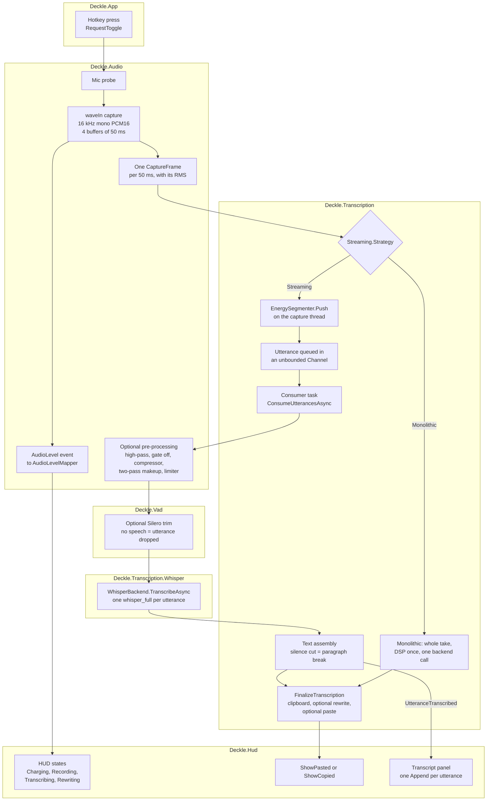
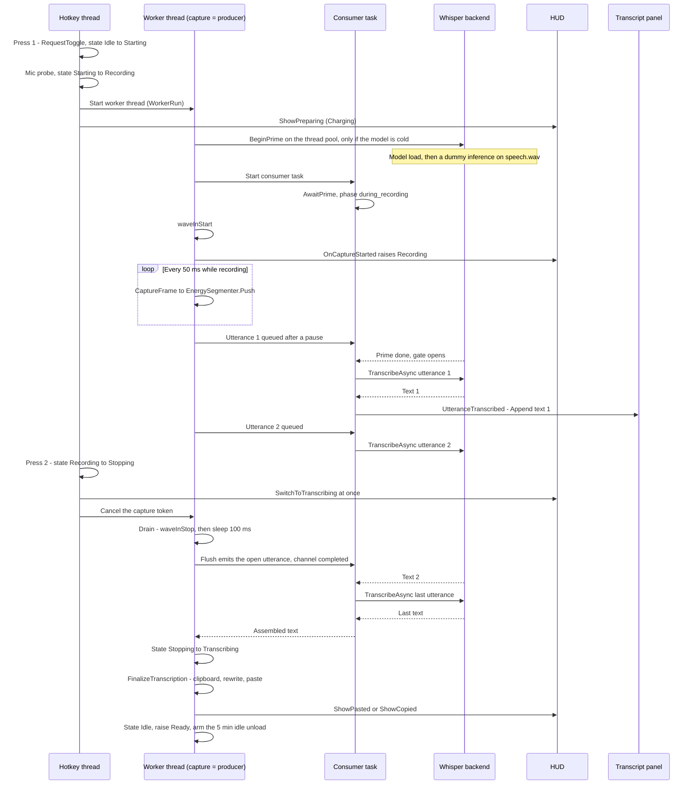
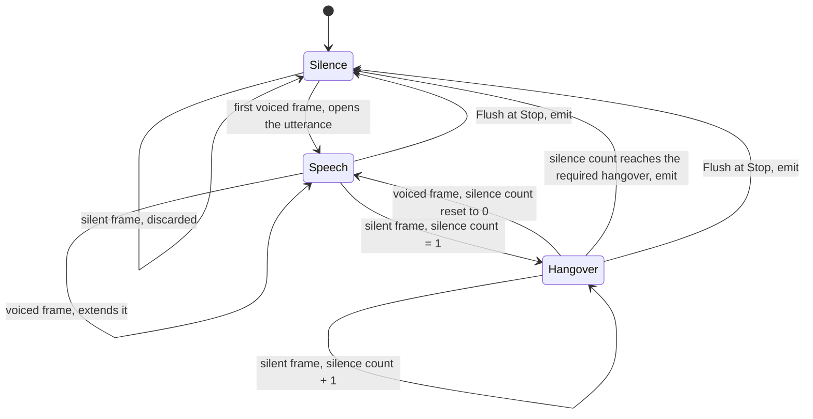

# The dictation chain

This note follows one dictation through Deckle, from the hotkey press to the text in the clipboard. It names each step, the file that does it, and the settings that change it. It is written to be read before the listening tests, so that a result can be traced back to a step and a parameter.

## How to read this note

Three markers tell you how solid each statement is.

- **Established**: read in the code. The file is named next to the statement. Most sentences in this note are of this kind, so they carry no extra marker.
- **Reading:** a paragraph that starts with this word is my interpretation of the code. It is likely, not proven.
- **Unverified**: something only running the app could show. The code alone cannot settle it.

Paths are relative to the repository root.

## Vocabulary

Most terms are defined in the module vocabularies. This list gives one line each and points to the file that owns the term.

- **Streaming** is the value `PipelineStrategyKind.Streaming` in `src/Deckle.Transcription/TranscriptionSettings.cs`. It is the pipeline that cuts the dictation into utterances while you speak and transcribes each one as soon as it ends. The text of each utterance then appears in the live transcript panel beside the HUD; there is no word-by-word display inside an utterance.
- **Monolithic** is the other value of the same enum. It captures the whole take, then makes one transcription call at the end.
- The code default is Monolithic, and the comment above the enum says the monolithic path "is slated for removal once streaming proves out".
- **Utterance** vs **segment**: an utterance is the audio span Deckle cuts and sends to Whisper in one call; a segment is a piece of text Whisper returns inside that call. See `src/Deckle.Transcription/CONTEXT.md`.
- **Neural VAD** vs **energy segmenter**: the neural VAD (Silero) is a model that finds speech inside a finished buffer; the energy segmenter is a volume threshold that cuts the live stream. See `src/Deckle.Transcription/CONTEXT.md`.
- **Hangover** vs **margin**: the hangover is how long the segmenter waits in silence before it decides an utterance has ended; the margin is how much of that silence it keeps at the end of the cut. See the header comment of `src/Deckle.Transcription/Streaming/EnergySegmenter.cs`.
- **Display level** vs **transcription pre-processing**: the display level only drives the HUD outline; pre-processing changes the audio sent to Whisper. See `src/Deckle.Audio/CONTEXT.md`.
- **Dictation** vs **file transcription**: the two entry points into the same pipeline. See `src/Deckle.Transcription/CONTEXT.md`.

## Diagram 1 — the chain, step by step

The main line is the Streaming path. The Monolithic path is the side branch at the strategy fork. Both end in the same finalize step.

Notes on the diagram:

- The hotkey is a toggle. The first press starts a take, the second press stops it. It is not push-to-talk (`RequestToggle` in `src/Deckle.Transcription/Engine/TranscriptionEngine.StateMachine.cs`).
- The fork is drawn after the frames for clarity. In the code, the strategy is chosen once per take in `WorkerRun`, before capture starts; the Monolithic path does not subscribe to frames.
- In Streaming, the pre-processing and the Silero trim run once per utterance, inside the consumer. In Monolithic, the pre-processing runs once over the whole take, and the Silero trim does not run at all (`src/Deckle.Transcription/Engine/TranscriptionEngine.MonolithicPipeline.cs`).
- File transcription is the second entry point: a tray command decodes an audio file and pushes its frames into the same energy segmenter, channel and consumer, then writes the text beside the file (`src/Deckle.Transcription/CONTEXT.md`, `src/Deckle.Transcription/Engine/TranscriptionEngine.FilePipeline.cs`). It is left out of the diagrams.

### Node → file

| Node | File (→ member) | What it does |
|---|---|---|
| Hotkey press | `src/Deckle.App/App.Hotkeys.cs` → `ToggleRecordingFromHotkey` → `_engine.RequestToggle`; `src/Deckle.Transcription/Engine/TranscriptionEngine.StateMachine.cs` → `RequestToggle` | The chord is `HotkeysSettings.Record` in `src/Deckle.Settings/Persistence/AppSettings.cs`: Win + the key left of 1 (scan code `0x29`) by default, editable in Settings ▸ General. The Record button of the tray panel lands on the same method. The press carries no rewrite profile: the active profile applies at finalize. A press while Idle starts; a press while Recording stops; any other state ignores the press. |
| Mic probe | `src/Deckle.Transcription/Engine/TranscriptionEngine.StateMachine.cs` → `TryStartFromIdleLocked` (`_capture.Probe`) | Checks the microphone before anything else. On failure, an error is shown and no take starts. Then the worker thread starts at AboveNormal priority. |
| waveIn capture | `src/Deckle.Audio/MicrophoneCapture.cs` → `Record` (`N_BUFFERS = 4`, `BYTES_PER_BUF` = 50 ms) | Opens the microphone at 16 kHz, mono, 16-bit, with a ring of four 50 ms buffers. |
| One CaptureFrame per 50 ms | `src/Deckle.Audio/Internal/WaveInLoop.cs` → `Pump`, `EmitSubWindows`; `src/Deckle.Audio/CaptureFrame.cs` | Cuts each buffer into 50 ms frames of 800 samples, computes the RMS (the average loudness) of each, and raises the `Frame` and `AudioLevel` events. The same loop runs the low-audio tracker described under the engine constants. |
| AudioLevel event | `src/Deckle.Audio/MicrophoneCapture.cs` → `AudioLevel`; `src/Deckle.App/App.Startup.Shell.cs` → `_engine.AudioLevel += _hudWindow.OnAudioLevel`; `src/Deckle.Audio/AudioLevelMapper.cs`; `src/Deckle.Hud/Chrono/HudChrono.Stroke.cs` | About 20 times per second, the RMS goes to the HUD, which maps it to the brightness of the outline. Display only. |
| Streaming.Strategy | `src/Deckle.Transcription/Engine/TranscriptionEngine.StateMachine.cs` → `WorkerRun` | Reads the strategy from the live settings at each take, so a change applies to the next dictation without restart. |
| EnergySegmenter.Push | `src/Deckle.Transcription/Streaming/EnergySegmenter.cs` → `Push`, `Flush`; called from `OnFrame` in `src/Deckle.Transcription/Engine/TranscriptionEngine.StreamingPipeline.cs` | Decides, frame by frame, whether you are speaking, pausing, or done. Runs on the capture thread. Detailed in the next section. |
| Utterance queued | `src/Deckle.Transcription/Streaming/SegmentedTranscriptionSession.cs` → `Channel.CreateUnbounded`; `src/Deckle.Transcription/Streaming/Utterance.cs` | Hands each finished utterance to the consumer. One writer, one reader, no size limit, plus a `Backlog` counter. |
| Consumer task | `src/Deckle.Transcription/Engine/TranscriptionEngine.StreamingPipeline.cs` → `ConsumeUtterancesAsync` | Takes utterances one by one, in order, and is the only caller of Whisper at a time. Waits at `AwaitPrime` before its first call. |
| Optional pre-processing | `src/Deckle.Audio/Preprocessing/TranscriptionPreprocessor.cs` → `Process`; `src/Deckle.Audio/Preprocessing/PreprocessingSettings.cs` | Off by default. When on: high-pass filter, noise gate (off), compressor, makeup gain to a target level in two passes, limiter. Works on a copy of the audio. |
| Optional Silero trim | `src/Deckle.Vad/VadService.cs` → `EnsureReady`; `src/Deckle.Vad/SileroVad.cs` → `Trim`; `src/Deckle.Vad/SileroSpeechTimestamps.cs` | On by default. Keeps only the speech inside the utterance. If no speech is found, the utterance is dropped. If the model file is missing, it starts a background download and this take runs untrimmed. |
| WhisperBackend.TranscribeAsync | `src/Deckle.Transcription.Whisper/WhisperBackend.Transcribe.cs` → `TranscribeSync`; `src/Deckle.Transcription.Whisper/Engine/WhisperParamsMapper.cs` → `Apply` | One `whisper_full` call per utterance. The prompt is the fixed `InitialPrompt` plus the last 30 words of the previous utterance (`BuildPriming`, `TailOf`, `PrimingTailWords`). Whisper's own VAD is forced off (`wparams.vad = 0`). |
| Text assembly | `src/Deckle.Transcription/Engine/TranscriptionEngine.StreamingPipeline.cs` → `pendingParagraphBreak = u.EndedOnSilence` | Joins the texts. After an utterance that ended on a silence, the next text starts a new paragraph (`\n\n`); otherwise a space. Only the last utterance of a take can end without a silence (the Flush at Stop), so in a dictation the texts are joined by paragraph breaks. See "The paragraph rule" below. |
| Monolithic | `src/Deckle.Transcription/Engine/TranscriptionEngine.MonolithicPipeline.cs` → `ProduceMonolithicAsync`; `src/Deckle.Transcription/Engine/TranscriptionEngine.Pipeline.cs` → `ConsumeMonolithicAudioAsync` | Captures the whole take, waits for the prime after Stop, runs the pre-processing once, makes one backend call. Whisper then cuts its own 30 s windows inside that call. |
| FinalizeTranscription | `src/Deckle.Transcription/Engine/TranscriptionEngine.Finalize.cs` → `FinalizeTranscription`, `CopyToClipboard`, `DeliverTranscript`, `PasteFromClipboard`; `src/Deckle.Transcription/Engine/TranscriptionEngine.Finalize.Rewrite.cs` → `ApplyRewrite` | Copies the raw text to the clipboard first. Then, if a rewrite profile applies, rewrites it with Ollama. Then pastes with Ctrl+V only if paste is enabled, the foreground window is not Deckle, and UI Automation confirms the focused element is a text field (Edit or Document). Paste is off by default (`AutoPasteEnabled = false` in `src/Deckle.Settings/Persistence/AppSettings.cs`). |
| HUD states | `src/Deckle.App/App.Startup.Shell.cs` → `StatusChanged` handler; `src/Deckle.App/App.Hotkeys.cs` → `ShowPreparing`, `SwitchToTranscribing`; `src/Deckle.Hud/Model/HudState.cs`; `src/Deckle.Hud/Windows/HudWindow.State.cs` | Start press → Charging. "Recording" status → Recording. Stop press → Transcribing at once. "Rewriting…" status → Rewriting. |
| ShowPasted or ShowCopied | `src/Deckle.App/App.Startup.Shell.cs` → `TranscriptionFinished` handler | Pasted → green flash. ClipboardOnly → the "copied" message. No text → the HUD hides. |
| Transcript panel | `src/Deckle.Transcription/Engine/TranscriptionEngine.StreamingPipeline.cs` → `UtteranceTranscribed?.Invoke` (event declared in `src/Deckle.Transcription/Engine/TranscriptionEngine.Utterances.cs`); `src/Deckle.App/App.TranscriptPanel.cs`; `src/Deckle.Hud/Transcript/TranscriptPanelWindow.xaml.cs` | Raised once per utterance that yields text, right after the text joins the assembly. The panel opens a take when the engine starts recording, appends each text with the same paragraph rule as the assembly (`src/Deckle.Hud/Transcript/TranscriptHistory.cs`), closes the take when the transcription finishes, and hides with the HUD. With the HUD turned off (`Overlay.Enabled`), no take opens. Its side is `Overlay.TranscriptPanelSide` (Settings ▸ Dictation). Monolithic raises no event, so the panel stays hidden. |

## Diagram 2 — one Streaming take over time

This diagram shows who does what, and when. The key point is that utterances are transcribed while you are still speaking, so at Stop only the last ones remain.

Notes on the diagram:

- On a warm model (used in the last 5 minutes), `BeginPrime` returns a finished task at once, and the consumer does not wait.
- On a cold model, the first utterances wait in the channel until the prime is done. The wait is hidden behind the recording, which is why its phase is named `during_recording` (`ConsumeUtterancesAsync`). In Monolithic the same wait happens after Stop and is named `at_stop`.
- The prime survives a Stop: it uses the drain token, which only Dispose cancels (`BeginPrime` in `src/Deckle.Transcription/Engine/TranscriptionEngine.Lifecycle.cs`).
- Reading: the two Whisper calls never overlap. The consumer is a sequential loop, the prime gate orders the first call after the dummy one, and `_transcribeLock` in `src/Deckle.Transcription.Whisper/WhisperBackend.Transcribe.cs` serialises native calls anyway.
- The engine state stays Stopping while the consumer drains the backlog. It moves to Transcribing only once the text is assembled. The HUD already shows Transcribing since the second press (`src/Deckle.App/App.Hotkeys.cs`).

### Node → file

| Step | File (→ member) |
|---|---|
| Press 1, Idle → Starting → Recording | `src/Deckle.Transcription/Engine/TranscriptionEngine.StateMachine.cs` → `RequestToggle`, `TryStartFromIdleLocked`; states in `src/Deckle.Transcription/Engine/TranscriptionEngine.cs` → `PipelineState` |
| ShowPreparing (Charging) | `src/Deckle.App/App.Hotkeys.cs` → `ToggleResult.Started`; `src/Deckle.Hud/Windows/HudWindow.State.cs` → `ShowPreparing` |
| Worker thread | `src/Deckle.Transcription/Engine/TranscriptionEngine.StateMachine.cs` → `WorkerRun` (`ThreadPriority.AboveNormal`) |
| BeginPrime, dummy inference | `src/Deckle.Transcription/Engine/TranscriptionEngine.Lifecycle.cs` → `BeginPrime`, `EnsurePrimed`, `TryLoadWarmupClip` (reads `Assets/Sounds/speech.wav` next to the exe) |
| Consumer task, AwaitPrime | `src/Deckle.Transcription/Engine/TranscriptionEngine.StreamingPipeline.cs` → `StartSegmentedTranscription`, `ConsumeUtterancesAsync`; `src/Deckle.Transcription/Engine/TranscriptionEngine.Lifecycle.cs` → `AwaitPrime` |
| waveInStart, Recording | `src/Deckle.Audio/MicrophoneCapture.cs` → `CaptureStarted`; `src/Deckle.Transcription/Engine/TranscriptionEngine.StateMachine.cs` → `OnCaptureStarted` |
| Frames to the segmenter | `src/Deckle.Transcription/Engine/TranscriptionEngine.StreamingPipeline.cs` → `ProduceStreamingAsync` (`OnFrame`); `src/Deckle.Transcription/Streaming/SegmentedTranscriptionSession.cs` → `Push` |
| Utterance queued | `src/Deckle.Transcription/Streaming/EnergySegmenter.cs` → `EmitOnSilence`; `src/Deckle.Transcription/Streaming/SegmentedTranscriptionSession.cs` → `TryWrite` |
| TranscribeAsync | `src/Deckle.Transcription.Whisper/WhisperBackend.Transcribe.cs` → `TranscribeAsync` |
| UtteranceTranscribed, Append | `src/Deckle.Transcription/Engine/TranscriptionEngine.StreamingPipeline.cs` → `ConsumeUtterancesAsync`; `src/Deckle.App/App.TranscriptPanel.cs`; `src/Deckle.Hud/Transcript/TranscriptPanelWindow.xaml.cs` → `Append` |
| Press 2, Recording → Stopping | `src/Deckle.Transcription/Engine/TranscriptionEngine.StateMachine.cs` → `RequestToggle` (`_recordCts.Cancel`) |
| SwitchToTranscribing at once | `src/Deckle.App/App.Hotkeys.cs` → `ToggleResult.Stopped` |
| Drain | `src/Deckle.Audio/Internal/WaveInLoop.cs` → `waveInStop`, `Thread.Sleep(100)`, last `EmitSubWindows` pass |
| Flush, channel completed | `src/Deckle.Transcription/Streaming/SegmentedTranscriptionSession.cs` → `Complete`; `src/Deckle.Transcription/Streaming/EnergySegmenter.cs` → `Flush` |
| Stopping → Transcribing | `src/Deckle.Transcription/Engine/TranscriptionEngine.StreamingPipeline.cs` → `ProduceStreamingAsync` (CAS after `session.Completion`) |
| Finalize | `src/Deckle.Transcription/Engine/TranscriptionEngine.Finalize.cs` → `FinalizeTranscription` |
| ShowPasted or ShowCopied | `src/Deckle.App/App.Startup.Shell.cs` → `TranscriptionFinished` handler |
| Idle, Ready, idle unload | `src/Deckle.Transcription/Engine/TranscriptionEngine.StateMachine.cs` → `SettleWorkerToIdle`; `src/Deckle.Transcription/Engine/TranscriptionEngine.Lifecycle.cs` → `ResetIdleTimer`, `UnloadModel`; `MODEL_IDLE_TIMEOUT_MS` in `src/Deckle.Transcription/Engine/TranscriptionEngine.cs` |

## Parameters

Where the files live:

- Transcription settings are stored in `<UserDataRoot>/modules/transcription/settings.json` (comment at the top of `src/Deckle.Transcription/TranscriptionSettings.cs`).
- Every settings file writes its keys in camelCase (`JsonNamingPolicy.CamelCase` in `src/Deckle.Transcription/TranscriptionSettingsService.cs`, `src/Deckle.Audio/CaptureSettingsService.cs` and `src/Deckle.Settings/Persistence/SettingsService.cs`). The section column below uses those keys.
- Audio settings are stored in `<UserDataRoot>/modules/audio/settings.json` (`src/Deckle.Audio/CaptureSettingsService.cs`). The file holds `CaptureSettings` at its root.
- `AutoPasteEnabled` lives in the app-wide `<UserDataRoot>/settings.json`, section `paste` (`src/Deckle.Settings/Persistence/AppSettings.cs`, `SettingsFilePath` in `src/Deckle.Core/Paths/AppPaths.cs`).
- `<UserDataRoot>` is `%LOCALAPPDATA%\Deckle`, unless the `DECKLE_DATA_ROOT` environment variable is set (`src/Deckle.Core/Paths/AppPaths.cs`).

Where the settings are shown:

- **Settings ▸ Dictation**: `src/Deckle.Transcription/ViewModels/WhisperViewModel.Settings.cs` (composed cards, including the cut curve card with its anchors and the curve editor `src/Deckle.Catalog/Composer/CurveEditor.cs`; no preset selector), plus the hand-written cards of `src/Deckle.Transcription/WhisperPage.xaml` and `src/Deckle.Transcription/WhisperPage.xaml.cs` (model, language, initial prompt).
- **Playground ▸ Segmentation**: `src/Deckle.Playground/ViewModels/SegmentationViewModel.cs`, with the curve plot `src/Deckle.Transcription/Ui/Controls/HangoverCurveCanvas.xaml.cs` on `src/Deckle.Playground/Views/Segmentation/SegmentationPage.xaml`. Edits there wait for a Save button.
- **Settings ▸ Recording**: `src/Deckle.Audio/RecordingViewModel.Settings.cs`, plus the microphone picker in `src/Deckle.Audio/RecordingPage.xaml.cs`.

### Transcription module — `modules/transcription/settings.json`

| Parameter | Acts in | Default in code | Stored in (section) | Exposed where |
|---|---|---|---|---|
| `Engine.Model` | `src/Deckle.Transcription.Whisper/WhisperBackend.Model.cs` (model load) | `"ggml-base.bin"` | `engine` | Dictation (model card, `WhisperPage.xaml`) |
| `Engine.UseGpu` | `src/Deckle.Transcription.Whisper/WhisperBackend.Model.cs` | `true` | `engine` | Dictation (`WhisperUseGpuCard`) |
| `Engine.Language` | `src/Deckle.Transcription.Whisper/Engine/WhisperParamsMapper.cs` | `"fr"` | `engine` | Dictation (`WhisperPage.xaml.cs`) |
| `Engine.InitialPrompt` | `src/Deckle.Transcription.Whisper/Engine/WhisperParamsMapper.cs`; in Streaming, the fixed part of every prompt (`ProduceStreamingAsync`) | A French paragraph about coding a Windows app (see the file) | `engine` | Dictation (`WhisperInitialPromptCard`) |
| `Engine.CarryInitialPrompt` | `src/Deckle.Transcription.Whisper/Engine/WhisperParamsMapper.cs` | `true` | `engine` | Not exposed |
| `Confidence.EntropyThreshold` | `src/Deckle.Transcription.Whisper/Engine/WhisperParamsMapper.cs` | `2.4` | `confidence` | Dictation (`WhisperEntropyCard`) |
| `Confidence.LogprobThreshold` | same | `-1.0` | `confidence` | Dictation (`WhisperLogprobCard`) |
| `Confidence.NoSpeechThreshold` | same | `0.6` | `confidence` | Dictation (`WhisperNoSpeechCard`) |
| `Decoding.Temperature` | same | `0.0` | `decoding` | Dictation (`WhisperTemperatureCard`) |
| `Decoding.TemperatureIncrement` | same | `0.2` | `decoding` | Dictation (`WhisperTemperatureIncrementCard`) |
| `Decoding.UseBeamSearch` | same | `true` | `decoding` | Dictation (`WhisperUseBeamSearchCard`) |
| `Decoding.BeamSize` | same | `5` | `decoding` | Dictation (`WhisperBeamSizeCard`, visible when beam search is on) |
| `Context.UseContext` | same (`no_context`) | `true` | `context` | Decoding page (Context section, `WhisperUseContextCard`) |
| `Context.MaxTokens` | same (`n_max_text_ctx`) | `-1` (auto) | `context` | Decoding page (Context section, `WhisperMaxTokensCard`) |
| `OutputFilters.SuppressNonSpeechTokens` | same | `true` | `outputFilters` | Decoding page (Output filters section, `WhisperSuppressNstCard`) |
| `OutputFilters.SuppressBlank` | same | `true` | `outputFilters` | Decoding page (Output filters section, `WhisperSuppressBlankCard`) |
| `OutputFilters.SuppressRegex` | same | `""` | `outputFilters` | Decoding page (Output filters section, `WhisperSuppressRegexCard`) |
| `Streaming.Strategy` | `src/Deckle.Transcription/Engine/TranscriptionEngine.StateMachine.cs` → `WorkerRun` | `Monolithic` | `streaming` | Dictation (`WhisperStreamingEnabledCard` toggle: on = Streaming) |
| `Streaming.Segmenter.ThresholdDbfs` | `src/Deckle.Transcription/Streaming/EnergySegmenter.cs` | `-45.0` | `streaming.segmenter` | Streaming page (`WhisperSegThresholdCard`, magnitude field in dBFS) and Playground |
| `Streaming.Segmenter.HangoverMaxMs` | same | `5000` | `streaming.segmenter` | Streaming page (cut curve card, legend field "Max wait", ms) and Playground |
| `Streaming.Segmenter.HangoverMinMs` | same | `500` | `streaming.segmenter` | Streaming page (cut curve card, legend field "Min wait", ms) and Playground |
| `Streaming.Segmenter.HangoverRampStartMs` | same | `15000` | `streaming.segmenter` | Streaming page (cut curve card, legend field "Ramp start", ms) and Playground |
| `Streaming.Segmenter.HangoverRampEndMs` | same | `120000` | `streaming.segmenter` | Streaming page (cut curve card, legend field "Ramp end", ms) and Playground |
| `Streaming.Segmenter.HangoverCurveX1` | same (via `src/Deckle.Transcription/Curves/UnitBezier.cs`) | `0.85` | `streaming.segmenter` | Streaming page (cut curve card, full-width editor, `WhisperCutCurveCard`) and Playground |
| `Streaming.Segmenter.HangoverCurveY1` | same | `0.10` | `streaming.segmenter` | Streaming page (cut curve card) and Playground |
| `Streaming.Segmenter.HangoverCurveX2` | same | `0.90` | `streaming.segmenter` | Streaming page (cut curve card) and Playground |
| `Streaming.Segmenter.HangoverCurveY2` | same | `0.25` | `streaming.segmenter` | Streaming page (cut curve card) and Playground |
| `Streaming.Segmenter.MarginMs` | same | `150` | `streaming.segmenter` | Playground only (removed from the Streaming page, 2026-10-14) |
| `Streaming.Segmenter.MinUtteranceMs` | same | `250` | `streaming.segmenter` | Playground only (removed from the Streaming page, 2026-10-14) |
| `Streaming.SpeechTrim.Enabled` | `src/Deckle.Transcription/Engine/TranscriptionEngine.StreamingPipeline.cs` → `StartSegmentedTranscription` | `true` | `streaming.speechTrim` | Streaming page (`WhisperVadEnabledCard`, the VAD group's switch, visible only when Streaming is on) |
| `Streaming.SpeechTrim.Threshold` | `src/Deckle.Vad/SileroSpeechTimestamps.cs` (via `src/Deckle.Vad/SileroVadOptions.cs`) | `0.5` | `streaming.speechTrim` | Streaming page (`WhisperVadThresholdCard`, child of the VAD group, shown while the group is on) |
| `Streaming.SpeechTrim.MinSpeechDurationMs` | same | `250` | `streaming.speechTrim` | Streaming page (`WhisperVadMinSpeechCard`, child of the VAD group) |
| `Streaming.SpeechTrim.MinSilenceDurationMs` | same | `100` | `streaming.speechTrim` | Streaming page (`WhisperVadMinSilenceCard`, child of the VAD group) |
| `Streaming.SpeechTrim.SpeechPadMs` | same | `30` | `streaming.speechTrim` | Streaming page (`WhisperVadSpeechPadCard`, child of the VAD group) |

On the Streaming page, everything under the Streaming switch shows only while the switch is on. Speech filtering comes first: the VAD group, its switch and its four children (threshold, minimum speech, minimum silence, padding), the children hidden while the group is off. Segmentation follows: the silence threshold as a magnitude field, then the cut curve card at full width, whose legend carries the four hangover anchors (Max wait, Min wait, Ramp start, Ramp end, in ms) beside the curve editor over the four control points. The cut presets (Patient, Balanced, Quick; `src/Deckle.Transcription/Streaming/CutPresets.cs`) still exist in code and the stored selection still flips to Custom on a hand edit, but no page selects one since 2026-10-14.

### Audio module — `modules/audio/settings.json`

| Parameter | Acts in | Default in code | Stored in (section) | Exposed where |
|---|---|---|---|---|
| `AudioInputDeviceId` | `src/Deckle.Audio/MicrophoneCapture.cs` (`Probe`, `Record`) | `-1` (system default device) | root | Recording (microphone picker, `RecordingPage.xaml.cs`) |
| `MaxRecordingDurationSeconds` | `src/Deckle.Audio/Internal/WaveInLoop.cs` (cap check, skipped at 0) | `0` (no limit); a file still holding the former 20 min default is migrated to 0 (`src/Deckle.Audio/CaptureSettingsService.cs`) | root | Recording (`RecordingLimitCard`, "Maximum recording length": No limit, 10, 20, 30 min, 1 h, 2 h) |
| `LevelWindow.MinDbfs` | `src/Deckle.Audio/AudioLevelMapper.cs` (HUD display only) | `-55` | `levelWindow` | Not exposed (removed from Recording, 2026-10-14) |
| `LevelWindow.MaxDbfs` | same | `-32` | `levelWindow` | Not exposed (removed from Recording, 2026-10-14) |
| `LevelWindow.DbfsCurveExponent` | same | `1.0` | `levelWindow` | Not exposed (removed from Recording, 2026-10-14) |
| `LevelWindow.AutoCalibrationEnabled` | `src/Deckle.Transcription/Engine/TranscriptionEngine.Telemetry.cs` → `TryAutoCalibrate` | `false` | `levelWindow` | Not exposed (removed from Recording, 2026-10-14) |
| `LevelWindow.AutoCalibrationSamples` | same | `5` | `levelWindow` | Not exposed |
| `Preprocessing.Enabled` | `src/Deckle.Audio/Preprocessing/TranscriptionPreprocessor.cs` | `false` | `preprocessing` | Recording (`RecordingPagePreprocessingCard`) |
| `Preprocessing.HighPassEnabled`, `HighPassHz` | same | `true`, `90` Hz | `preprocessing` | Not exposed |
| `Preprocessing.GateEnabled`, `GateThresholdDbfs`, `GateRatio`, `GateAttackMs`, `GateReleaseMs` | same | `false`, `-55`, `2`, `5`, `150` | `preprocessing` | Not exposed |
| `Preprocessing.CompressorEnabled`, `CompThresholdDbfs`, `CompRatio`, `CompKneeDb`, `CompAttackMs`, `CompReleaseMs` | same | `true`, `-24`, `2`, `6`, `8`, `150` | `preprocessing` | Not exposed |
| `Preprocessing.TargetRmsDbfs`, `MaxMakeupGainDb` | same | `-20`, `24` | `preprocessing` | Not exposed |
| `Preprocessing.LimiterEnabled`, `LimiterCeilingDbfs`, `LimiterReleaseMs` | same | `true`, `-1`, `50` | `preprocessing` | Not exposed |

The pre-processing has 18 fixed fields after `Enabled`: four stage switches and fourteen values. `PreprocessingSettings.cs` says they are "an engineer's starting point, NOT measured optima". No Settings card and no Playground page edits them.

Reading: `LevelWindowSettings` uses public fields, while every other settings class uses properties "so System.Text.Json round-trips them". Whether the level window survives a restart is not established here.

### Constants in the engine, not stored

| Constant | Where | Value | Exposed |
|---|---|---|---|
| `PrimingTailWords` | `src/Deckle.Transcription/Engine/TranscriptionEngine.StreamingPipeline.cs` | `30` words of the previous utterance added to the prompt | No |
| `MODEL_IDLE_TIMEOUT_MS` | `src/Deckle.Transcription/Engine/TranscriptionEngine.cs` | `5 * 60 * 1000` (5 min) before the model is freed | No |
| `N_BUFFERS`, `BYTES_PER_BUF` | `src/Deckle.Audio/MicrophoneCapture.cs` | 4 buffers of 50 ms (1600 bytes) | No |
| `FrameMs` | `src/Deckle.Transcription/Streaming/EnergySegmenter.cs` | `50` ms; every segmenter duration is rounded to whole frames | No |
| Low-audio warning: `NormalVoiceDbfsThreshold`, `NormalVoiceSustainedMs`, `WarnAfterSilenceMs` | `src/Deckle.Audio/Internal/WaveInLoop.cs` (the per-buffer tracker in `Pump`) | If the first 5 s of a take never contain 200 ms in a row at or above −45 dBFS, the capture raises `LowAudioDetected` once, and `OnCaptureLowAudioDetected` in `src/Deckle.Transcription/Engine/TranscriptionEngine.cs` shows the `Engine_LowAudio_Title` / `Engine_LowAudio_Body` overlay | No |

### Louis's own values

Louis reports that he runs the Streaming strategy with the segmenter threshold at −38 dBFS. Both values live in his own `settings.json`, outside the repository, so this note cannot establish them. The code defaults stay Monolithic and −45 dBFS.

## Latencies

### What the code measures for each take

At the end of each dictation, `RecordPipelineMetrics` emits the `LatencyRecorded` event (`src/Deckle.Transcription/Engine/TranscriptionEngine.Finalize.Observability.cs`). It is not emitted for file transcription. The table lists the dictation-chain timings. The same event also carries three rewrite sub-timings (`ollama_load_ms`, `llm_prompt_eval_ms`, `llm_eval_ms`, set in the same file); they are left out here because they belong to the rewrite.

| Field | Start → end | Where it is measured |
|---|---|---|
| `model_load_ms` | Model load, cold takes only; 0 when warm | `LoadModel` in `src/Deckle.Transcription/Engine/TranscriptionEngine.Lifecycle.cs` |
| `hotkey_to_capture_ms` | Start press → `waveInStart` | `_hotkeySw`, started in `TryStartFromIdleLocked`, stopped in `OnCaptureStarted` |
| `record_drain_ms` | `waveInStop` → last buffers read | `DrainDuration` in `src/Deckle.Audio/Internal/WaveInLoop.cs` |
| `stop_to_pipeline_ms` | Stop press → Streaming: consumer finished draining; Monolithic: handoff to the backend | `_stopToPipelineSw`, started in `RequestToggle`, stopped in `ProduceStreamingAsync` or `ProduceMonolithicAsync` |
| `whisper_init_ms` | The init stopwatch, summed over all utterances. It starts just before `whisper_full` and stops when it returns, so it spans the whole call and is about the total, not an init phase | `InitDurationMs` of each `TranscriptionResult` (`_whisperInitSw` in `src/Deckle.Transcription.Whisper/WhisperBackend.Transcribe.cs`) |
| `whisper_ms` | Whisper's total time minus `whisper_init_ms`, summed over all utterances; about 0 for the reason above | same |
| `llm_ms` | Ollama rewrite, 0 without a profile | `src/Deckle.Transcription/Engine/TranscriptionEngine.Finalize.Rewrite.cs` |
| `clipboard_ms` | Raw copy to the clipboard | `FinalizeTranscription` |
| `paste_ms` | UI Automation check plus Ctrl+V, 0 when paste is off | `DeliverTranscript` |

On a cold take, `AwaitPrime` also emits `PrimeOverlap` with the prime's own duration, the time the gate actually waited, and the phase (`during_recording` or `at_stop`) (`src/Deckle.Transcription/Engine/TranscriptionEngine.Lifecycle.cs`). It shows how much of the cold cost the recording hid.

Reading: in Streaming, `stop_to_pipeline_ms` is the delay you feel after the second press, minus finalize. It includes the drain and the transcription of whatever utterances were still queued.

The Latency toggle is `LatencyEnabled` in `src/Deckle.Diagnostics.Telemetry/TelemetrySettings.cs`, and its default is `false`. `src/Deckle.Diagnostics.Telemetry/TelemetryListenerBootstrap.cs` writes `LatencyRecorded` events to `latency.jsonl` only while it is `true`. The event itself is emitted on every dictation, whatever the toggle.

A code comment in `EnsurePrimed` says the dummy inference takes "~200–800 ms on RX 7900 XT with Vulkan ggml". That is a comment, not a measurement this note can rely on.

### Delays built into the code

These are fixed by the code. They are not measured; they are the minimum or the step size of each stage.

| Delay | Value | Where |
|---|---|---|
| Capture frame | 50 ms (800 samples at 16 kHz) | `src/Deckle.Audio/Internal/WaveInLoop.cs` → `EmitSubWindows` |
| Capture ring | 4 × 50 ms = 200 ms of headroom before the driver drops audio | `src/Deckle.Audio/MicrophoneCapture.cs` |
| Capture poll | `WaitForSingleObject(hEvent, 100)`: wakes on each buffer, or after 100 ms at most | `src/Deckle.Audio/Internal/WaveInLoop.cs` |
| Drain after Stop | `waveInStop`, then `Thread.Sleep(100)`: at least 100 ms | `src/Deckle.Audio/Internal/WaveInLoop.cs` |
| Margin | 150 ms of silence kept after the last voiced frame | `EnergySegmenterSettings.MarginMs` |
| Hangover | 500 ms to 5 s of silence before a cut, depending on how long the utterance already is | `EnergySegmenterSettings.HangoverMinMs`, `HangoverMaxMs` |
| Heartbeat log | once per second (every 20 frames), only when verbose logging is on | `OnFrame` in `src/Deckle.Transcription/Engine/TranscriptionEngine.StreamingPipeline.cs` |
| Idle unload | model freed 5 min after the last take | `MODEL_IDLE_TIMEOUT_MS` in `src/Deckle.Transcription/Engine/TranscriptionEngine.cs` |

Reading: the hangover is the largest built-in delay. An utterance is handed to Whisper only once its trailing silence reaches the hangover. With the defaults, a sentence shorter than 15 s waits for 5 s of silence. The next section explains this.

## Segmentation

In Streaming, the energy segmenter decides where one utterance ends and the next begins. It listens to the volume only. It does not know what a word is. This section explains its rules, then what happens to an utterance after the cut.

### A frame and the threshold

A **frame** is one 50 ms slice of the microphone signal: 800 samples at 16 kHz, with its RMS, the average loudness of those samples on a linear scale from 0 to 1 (`src/Deckle.Audio/CaptureFrame.cs`). The segmenter receives one frame at a time, in order, and decides for each one whether it is **voiced** (loud enough to count as speech) or **silent**.

The test is a single comparison. The constructor turns the threshold from decibels into the same linear scale once: `10^(ThresholdDbfs / 20)`. A frame is voiced when its RMS is at or above that value (`EnergySegmenter` constructor and `Push` in `src/Deckle.Transcription/Streaming/EnergySegmenter.cs`). With the default −45 dBFS, the limit is an RMS of about 0.0056. With −38 dBFS, the value Louis reports using, it is about 0.0126: a frame must be about twice as loud to count as speech.

Reading: a higher threshold (closer to 0) makes quiet breaths and room noise count as silence, so pauses are detected more easily; it also risks counting the soft end of a word as silence.

### Diagram 3 — the three states of the segmenter

How to read it:

- **Silence**: no utterance is open. Silent frames are thrown away. The first voiced frame opens a new utterance, and that frame is its first sample: nothing before it is kept.
- **Speech**: an utterance is open and the last frame was voiced. Every frame is added to it, voiced or silent.
- **Hangover**: an utterance is open, and the last frames were silent. The segmenter is not sure yet whether this is a short pause inside a sentence or the end. It counts the silent frames in a row. A voiced frame sets the count back to 0 and returns to Speech. When the count reaches the required hangover, the segmenter cuts and emits the utterance with `EndedOnSilence = true`.
- **Flush at Stop**: when you press the hotkey to stop, the open utterance is emitted whatever its state, with `EndedOnSilence = false`. In Silence, Flush does nothing.
- The step Speech → Hangover also checks the required hangover. With the defaults it never cuts there, because the minimum hangover is 10 frames. It only matters if a hangover rounds to one frame (under 75 ms: `FramesFromMs` uses `Math.Round`, which rounds 75 ms, 1.5 frames, to 2).
- The segmenter has no maximum utterance length. An utterance only ends on a silence long enough, or at Stop. The header of `EnergySegmenter.cs` says so ("No hard cap"). Reading: `src/Deckle.Transcription/Streaming/Utterance.cs` and `src/Deckle.Transcription/CONTEXT.md` still mention a "safety ceiling"; the code has no such ceiling. The only cap is the optional capture limit (`MaxRecordingDurationSeconds`, off by default), which ends the whole take through the same Flush when the user has set one.

#### Node → file

| Node or transition | File (→ member) |
|---|---|
| Silence, Speech, Hangover | `src/Deckle.Transcription/Streaming/EnergySegmenter.cs` → `enum State` |
| Voiced or silent frame | same → `Push` (`frame.Rms >= _rmsThreshold`); threshold computed in the constructor |
| Opens the utterance | same → `Push`, case `State.Silence` (`_utteranceStartFrame`, `_lastVoicedIdx = 0`) |
| Silence count | same → `_hangoverCount`, cases `State.Speech` and `State.Hangover` |
| Required hangover | same → `RequiredHangoverFrames`; curve in `src/Deckle.Transcription/Curves/UnitBezier.cs` → `Solve` |
| Emit on silence | same → `EmitOnSilence` → `EmitKept(endedOnSilence: true)` → `Emit` |
| Flush at Stop | same → `Flush` → `EmitKept(endedOnSilence: false)`; called by `src/Deckle.Transcription/Streaming/SegmentedTranscriptionSession.cs` → `Complete` |
| Back to Silence | same → `ResetToSilence` |
| Emitted utterance | `src/Deckle.Transcription/Streaming/Utterance.cs`; written to the channel in `SegmentedTranscriptionSession.cs` (constructor callback) |
| Live state in the logs | `EnergySegmenter.cs` → `Snapshot`; read by the 1 Hz heartbeat in `OnFrame` (`src/Deckle.Transcription/Engine/TranscriptionEngine.StreamingPipeline.cs`) |

### The hangover ramp

The required hangover is not fixed. It gets shorter as the open utterance gets longer, so that a long monologue is cut on shorter pauses than a short sentence (`RequiredHangoverFrames` in `src/Deckle.Transcription/Streaming/EnergySegmenter.cs`):

- While the open utterance is at or below `HangoverRampStartMs` (15 s), the required hangover is `HangoverMaxMs` (5 s).
- At or above `HangoverRampEndMs` (120 s), it is `HangoverMinMs` (500 ms).
- In between, it goes from the maximum down to the minimum along a curve. The progress through the ramp (0 at its start, 1 at its end) goes into `UnitBezier.Solve`, which returns how far the delay has dropped (0 = still at the maximum, 1 = at the minimum). The curve is a cubic Bézier, the same function as CSS `cubic-bezier(x1, y1, x2, y2)`, with the control points `HangoverCurveX1`, `HangoverCurveY1`, `HangoverCurveX2`, `HangoverCurveY2` (`src/Deckle.Transcription/Curves/UnitBezier.cs`). The defaults (0.85, 0.10, 0.90, 0.25) keep the delay near the maximum for most of the ramp, then drop it late.

Three details from the code:

- Every duration is rounded to whole 50 ms frames once, in the constructor (`FramesFromMs`). 5000 ms is 100 frames, 500 ms is 10 frames, 150 ms is 3 frames.
- If `HangoverMinMs` is set above `HangoverMaxMs`, the minimum is lowered to the maximum. If `HangoverRampEndMs` is set below `HangoverRampStartMs`, the end is raised to the start. So the delay can only stay the same or shrink as the utterance grows.
- The length that drives the ramp is the number of frames in the open utterance, and that includes the silent frames of the current hangover. Reading: during a long pause, the requirement can therefore shrink a little while the pause goes on; with the defaults this changes at most a few frames.

Required hangover at a given utterance length, with the default values. **Computed from the code, not measured**: the values come from reproducing `UnitBezier.Solve` (Newton-Raphson, then bisection, precision 1e-6) and the rounding of `RequiredHangoverFrames`.

| Utterance length | Progress in the ramp | Curve output | Required hangover |
|---|---|---|---|
| 0 s | before the ramp | — | 100 frames = 5000 ms |
| 15 s | ramp start (included in the maximum) | — | 100 frames = 5000 ms |
| 30 s | 0.143 | 0.018 | 98 frames = 4900 ms |
| 60 s | 0.429 | 0.072 | 93 frames = 4650 ms |
| 90 s | 0.714 | 0.196 | 82 frames = 4100 ms |
| 120 s | ramp end | — | 10 frames = 500 ms |

The drop is late, as the comment in `src/Deckle.Transcription/Streaming/EnergySegmenterSettings.cs` says: with the same calculation, 105 s still requires 3350 ms, and the curve only falls steeply in the last 15 s before 120 s. Reading: in practice, with the defaults, an utterance under a minute needs a pause of more than 4.5 seconds to be cut.

### Hangover vs margin

These two values are often confused. They answer two different questions.

- The **hangover** answers "when do I decide?". It is how much silence the segmenter waits for before it cuts.
- The **margin** (`MarginMs`, 150 ms by default) answers "where do I cut?". The kept audio ends `MarginMs` after the last voiced frame. The silence between the end of the margin and the moment of the decision is thrown away (`EmitKept` in `src/Deckle.Transcription/Streaming/EnergySegmenter.cs`: kept frames = voiced extent + margin frames, never more than the frames held).

A worked example with the defaults. You start a take and speak for 3 s. You pause for 0.8 s, then speak for 4 s more. Then you pause for 6 s.

1. The first voiced frame opens the utterance. The state is Speech.
2. The 0.8 s pause is 16 silent frames. The state moves to Hangover and the count rises to 16. The utterance is only about 4 s long, so the required hangover is 100 frames. Your voice comes back before that: the count goes back to 0, the state returns to Speech. No cut.
3. The 6 s pause starts after about 7.8 s of utterance. The count rises frame by frame. After 5 s of silence (100 frames, since the utterance is still under 15 s), the segmenter cuts.
4. The emitted utterance is the 7.8 s from the first voiced frame to the last voiced frame, plus 150 ms of margin: about 7.95 s. The other 4.85 s of silence already collected are dropped. `EndedOnSilence` is true.
5. The state is back to Silence. The last second of the pause is discarded frame by frame. Your next voiced frame opens a new utterance.

Reading: the hangover is what you wait for, not what Whisper hears. Whisper only receives the margin of silence; the long wait only delays the moment the utterance reaches the consumer.

### The blip floor

A short noise, such as a click or a cough, can open an utterance. When the segmenter emits, it measures the **voiced extent**: from the first frame to the last voiced frame. If that is shorter than `MinUtteranceMs` (250 ms, 5 frames), the utterance is dropped instead of emitted, and the `SegmenterBlipDropped` event is logged (`EmitKept` in `src/Deckle.Transcription/Streaming/EnergySegmenter.cs`, event in `src/Deckle.Transcription/DeckleWhispSource.Streaming.cs`). The same rule applies at Flush.

### After the cut: what the consumer does with an utterance

The consumer takes the utterances one at a time, in order (`ConsumeUtterancesAsync` in `src/Deckle.Transcription/Engine/TranscriptionEngine.StreamingPipeline.cs`). For each one:

1. **Optional pre-processing.** If `Preprocessing.Enabled` is on (off by default), the audio of this utterance alone goes through `TranscriptionPreprocessor.Process` (`src/Deckle.Audio/Preprocessing/TranscriptionPreprocessor.cs`).
2. **Optional Silero trim.** If `Streaming.SpeechTrim.Enabled` is on (the default) and the model is loaded, the neural VAD keeps only the speech inside the utterance (`Trim` in `src/Deckle.Vad/SileroVad.cs`, decisions in `src/Deckle.Vad/SileroSpeechTimestamps.cs`, values in `src/Deckle.Vad/SileroVadOptions.cs`):
   - The audio is cut into windows of 512 samples (32 ms). The model gives each window a probability of speech.
   - A span of speech starts at the first window whose probability is at or above `Threshold` (0.5).
   - It is released only below `Threshold − 0.15` (0.35 by default, never below 0.01). Between the two values, an open span stays open.
   - A silence shorter than `MinSilenceDurationMs` (100 ms) does not close a span. When the silence lasts long enough, the span ends where that silence began.
   - A span of `MinSpeechDurationMs` (250 ms) or less is dropped.
   - Each kept span gets `SpeechPadMs` (30 ms) of padding on both sides. When two spans are closer than twice the padding, the gap between them is split in half instead.
   - The kept spans are joined end to end. The silence between them is removed.
   - If no span is found, the utterance is dropped (`UtteranceDroppedNoSpeech`) and contributes no text. The tail of the previous text is kept for the next prompt.
   - If the trim throws an error, the utterance goes to Whisper untrimmed and the trim is turned off for the rest of the take.
3. **Whisper**, one call per utterance (see Diagram 1).

Why two detectors: the energy segmenter must decide live, frame by frame, with only the volume to go on; the neural VAD can look at a finished buffer as a whole and tell speech from noise. The distinction is defined in `src/Deckle.Transcription/CONTEXT.md`, section [Segmentation — detection vs cutting](../src/Deckle.Transcription/CONTEXT.md#segmentation--detection-vs-cutting).

Reading: the segmenter discards everything before the first voiced frame, and the Silero padding works inside the utterance it receives. So the padding cannot bring back a soft word onset that stayed under the energy threshold.

### The paragraph rule

Each utterance carries `EndedOnSilence` (`src/Deckle.Transcription/Streaming/Utterance.cs`): true when the segmenter cut on a pause, false when the Flush at Stop closed it. The consumer uses it to join the texts (`pendingParagraphBreak` in `ConsumeUtterancesAsync`):

- Before the text of an utterance, if text was already written, it adds `\n\n` (a new paragraph) when the previous utterance with text was cut on a silence, and a space otherwise.
- The flag is only updated by an utterance that yields text. An utterance dropped by Silero, one that fails in Whisper, or one whose text is empty leaves the pending break as it was.

Every utterance except the last one of a take is cut on a silence, because Flush only runs at Stop. Reading: so in a dictation, two texts are always joined by a paragraph break, and the space branch is not reached; every pause long enough to cut (5 s at the start of an utterance with the defaults) becomes a new paragraph.

### Stop

On a user Stop, the capture drains its last buffers, then `Complete` runs (`src/Deckle.Transcription/Streaming/SegmentedTranscriptionSession.cs`):

1. `Flush` emits the open utterance, if any, with the same margin rule: voiced extent + margin, limited to the frames held, so a Stop in the middle of a word still keeps the word. `EndedOnSilence` is false. The blip floor still applies.
2. The channel is marked complete. No more utterances can be written.
3. The consumer keeps reading until the channel is empty, then returns the assembled text.

Nothing queued is lost on a user Stop: the consumer is cancelled only by `drainCt`, which only Dispose triggers (header comment of `src/Deckle.Transcription/Engine/TranscriptionEngine.StreamingPipeline.cs`).

### What is not exposed

- The 50 ms frame (`FrameMs` in `EnergySegmenter.cs`) and the ring of four 50 ms capture buffers (`src/Deckle.Audio/MicrophoneCapture.cs`) are fixed in code.
- The Silero window (512 samples) and the release gap (0.15) are fixed in `src/Deckle.Vad/SileroSpeechTimestamps.cs`.

### Unverified

- Whether −38 dBFS separates speech from silence well on Louis's microphone and room. Only a recording with the heartbeat log on would show it.
- How often the blip floor and the Silero trim drop a real utterance in practice.
- Whether the late drop of the default curve matches how Louis actually pauses: the table above is computed, not observed.
- The real time between the end of speech and the text, per utterance. The code logs it piece by piece (heartbeat, `ConsumerUtterance`); no measurement is quoted here.
